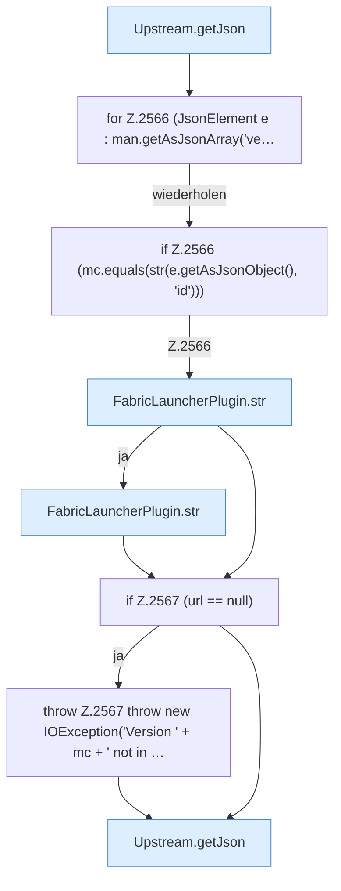

[[00 Start]] › [[Plugin-Kern]] › [[Properties]] › [[FabricLauncherPlugin.prepareFiles]] › [[FabricLauncherPlugin.prepareFiles.Z2531.Case2561.Z2563.Teil1]]

# FabricLauncherPlugin.prepareFiles.Z2531.Case2561.Z2563.Teil1



```knoten
Upstream.getJson
  Dieser Teil liefert die Antwort. Liefert `getJson`.
for Z.2566 (JsonElement e : man.getAsJsonArray('ve…
  Zeile 2566: Schleife `(JsonElement e : man.getAsJsonArray('ve…`.
if Z.2566 (mc.equals(str(e.getAsJsonObject(), 'id')))
  Zeile 2566: prüft `(mc.equals(str(e.getAsJsonObject(), 'id')))`.
FabricLauncherPlugin.str
  Das [[Glossar#Plugin|Plugin]] macht hier einen einzelnen Schritt. Eine Ebene tiefer steht er genauer. `str` in `FabricLauncherPlugin.java`.
if Z.2567 (url == null)
  Zeile 2567: prüft `(url == null)`.
throw Z.2567 throw new IOException('Version ' + mc + ' not in …
  Zeile 2567: Abbruch `throw new IOException('Version ' + mc + ' not in …`.
```

> [!knoten]- Was die Blöcke tun
> - **Upstream.getJson**: Dieser Teil liefert die Antwort. Liefert `getJson`.
> - **for Z.2566 (JsonElement e : man.getAsJsonArray('ve…**: Zeile 2566: Schleife `(JsonElement e : man.getAsJsonArray('ve…`.
> - **if Z.2566 (mc.equals(str(e.getAsJsonObject(), 'id')))**: Zeile 2566: prüft `(mc.equals(str(e.getAsJsonObject(), 'id')))`.
> - **FabricLauncherPlugin.str**: Das [[Glossar#Plugin|Plugin]] macht hier einen einzelnen Schritt. Eine Ebene tiefer steht er genauer. `str` in `FabricLauncherPlugin.java`.
> - **if Z.2567 (url == null)**: Zeile 2567: prüft `(url == null)`.
> - **throw Z.2567 throw new IOException('Version ' + mc + ' not in …**: Zeile 2567: Abbruch `throw new IOException('Version ' + mc + ' not in …`.

- Ein weiterer Abschnitt derselben Übersicht.
- Fortsetzung von `FabricLauncherPlugin.prepareFiles.Z2531.Case2561.Z2563`.
