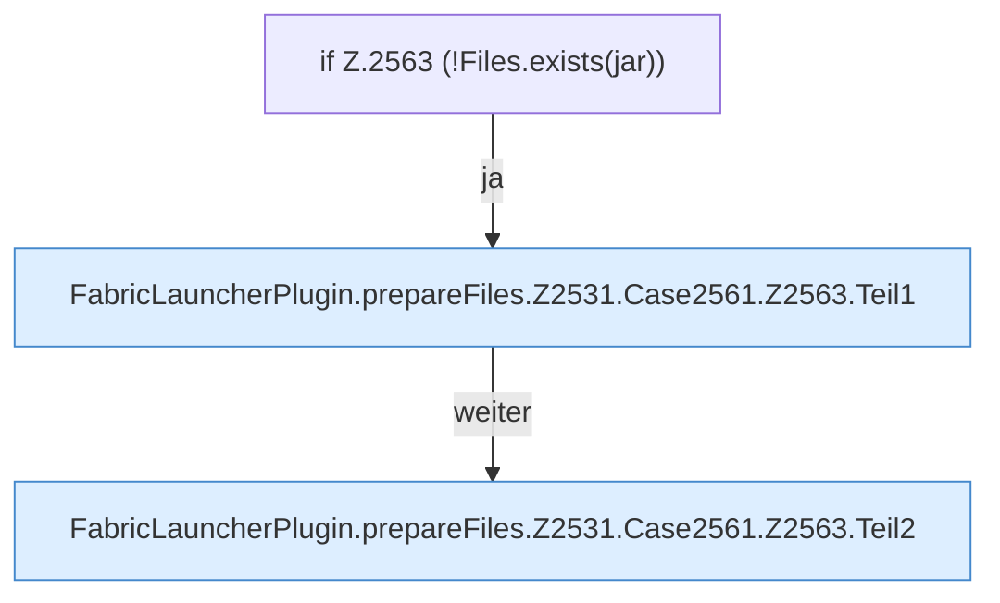

[[00 Start]] › [[Plugin-Kern]] › [[Properties]] › [[FabricLauncherPlugin.prepareFiles]] › [[FabricLauncherPlugin.prepareFiles.Z2531.Case2561.Z2563]]

# FabricLauncherPlugin.prepareFiles.Z2531.Case2561.Z2563



```knoten
if Z.2563 (!Files.exists(jar))
  Zeile 2563: prüft `(!Files.exists(jar))`.
FabricLauncherPlugin.prepareFiles.Z2531.Case2561.Z2563.Teil1
  Ein weiterer Abschnitt derselben Übersicht. Abschnitt 1 dieses Ablaufs, in Quellreihenfolge.
FabricLauncherPlugin.prepareFiles.Z2531.Case2561.Z2563.Teil2
  Ein weiterer Abschnitt derselben Übersicht. Abschnitt 2 dieses Ablaufs, in Quellreihenfolge.
```

> [!knoten]- Was die Blöcke tun
> - **if Z.2563 (!Files.exists(jar))**: Zeile 2563: prüft `(!Files.exists(jar))`.
> - **FabricLauncherPlugin.prepareFiles.Z2531.Case2561.Z2563.Teil1**: Ein weiterer Abschnitt derselben Übersicht. Abschnitt 1 dieses Ablaufs, in Quellreihenfolge.
> - **FabricLauncherPlugin.prepareFiles.Z2531.Case2561.Z2563.Teil2**: Ein weiterer Abschnitt derselben Übersicht. Abschnitt 2 dieses Ablaufs, in Quellreihenfolge.

- Der Ablauf geht in [[Glossar#Zeile|Zeile]] 2563 weiter. Eine Ebene tiefer steht er genauer.
- Fortsetzung von `FabricLauncherPlugin.prepareFiles.Z2531.Case2561`.
