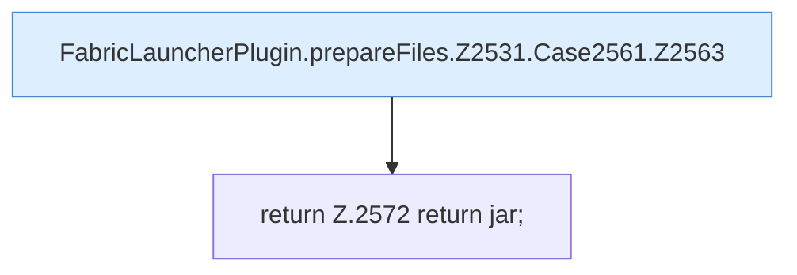

[[00 Start]] › [[Plugin-Kern]] › [[Properties]] › [[FabricLauncherPlugin.prepareFiles]] › [[FabricLauncherPlugin.prepareFiles.Z2531.Case2561]]

# FabricLauncherPlugin.prepareFiles.Z2531.Case2561



```knoten
FabricLauncherPlugin.prepareFiles.Z2531.Case2561.Z2563
  Der Ablauf geht in [[Glossar#Zeile|Zeile]] 2563 weiter. Eine Ebene tiefer steht er genauer. Fortsetzung des Ablaufs ab Zeile 2563.
return Z.2572 return jar;
  Zeile 2572: Rückgabe `return jar;`.
```

> [!knoten]- Was die Blöcke tun
> - **FabricLauncherPlugin.prepareFiles.Z2531.Case2561.Z2563**: Der Ablauf geht in [[Glossar#Zeile|Zeile]] 2563 weiter. Eine Ebene tiefer steht er genauer. Fortsetzung des Ablaufs ab Zeile 2563.
> - **return Z.2572 return jar;**: Zeile 2572: Rückgabe `return jar;`.

- Das Innere eines Wegs, ab [[Glossar#Zeile|Zeile]] 2561.
- Fortsetzung von `FabricLauncherPlugin.prepareFiles.Z2531`.
