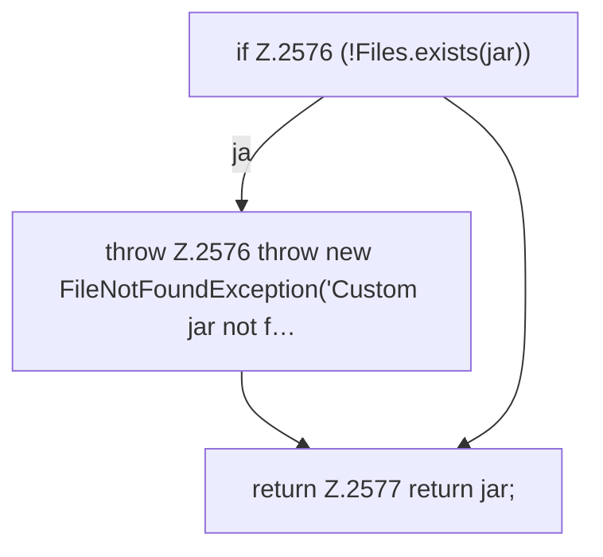

[[00 Start]] › [[Plugin-Kern]] › [[Properties]] › [[FabricLauncherPlugin.prepareFiles]] › [[FabricLauncherPlugin.prepareFiles.Z2531.Case2574]]

# FabricLauncherPlugin.prepareFiles.Z2531.Case2574



```knoten
if Z.2576 (!Files.exists(jar))
  Zeile 2576: prüft `(!Files.exists(jar))`.
throw Z.2576 throw new FileNotFoundException('Custom jar not f…
  Zeile 2576: Abbruch `throw new FileNotFoundException('Custom jar not f…`.
return Z.2577 return jar;
  Zeile 2577: Rückgabe `return jar;`.
```

- Fortsetzung von `FabricLauncherPlugin.prepareFiles.Z2531`, Quellreihenfolge.
