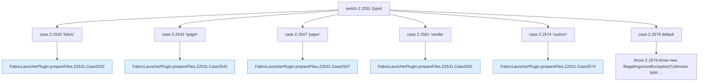

[[00 Start]] › [[Plugin-Kern]] › [[Properties]] › [[FabricLauncherPlugin.prepareFiles]] › [[FabricLauncherPlugin.prepareFiles.Z2531]]

# FabricLauncherPlugin.prepareFiles.Z2531



```knoten
switch Z.2531 (type)
  Zeile 2531: Verzweigung nach `(type)`.
case Z.2532 'fabric'
  Zeile 2532: Zweig `'fabric'`.
FabricLauncherPlugin.prepareFiles.Z2531.Case2532
  Rumpf dieses switch-Zweigs ab Zeile 2532.
case Z.2543 'spigot'
  Zeile 2543: Zweig `'spigot'`.
FabricLauncherPlugin.prepareFiles.Z2531.Case2543
  Rumpf dieses switch-Zweigs ab Zeile 2543.
case Z.2547 'paper'
  Zeile 2547: Zweig `'paper'`.
FabricLauncherPlugin.prepareFiles.Z2531.Case2547
  Rumpf dieses switch-Zweigs ab Zeile 2547.
case Z.2561 'vanilla'
  Zeile 2561: Zweig `'vanilla'`.
FabricLauncherPlugin.prepareFiles.Z2531.Case2561
  Rumpf dieses switch-Zweigs ab Zeile 2561.
case Z.2574 'custom'
  Zeile 2574: Zweig `'custom'`.
FabricLauncherPlugin.prepareFiles.Z2531.Case2574
  Rumpf dieses switch-Zweigs ab Zeile 2574.
case Z.2579 default
  Zeile 2579: Zweig `default`.
throw Z.2579 throw new IllegalArgumentException('Unknown type:…
  Zeile 2579: Abbruch `throw new IllegalArgumentException('Unknown type:…`.
```

- Fortsetzung von `FabricLauncherPlugin.prepareFiles`, Quellreihenfolge.
