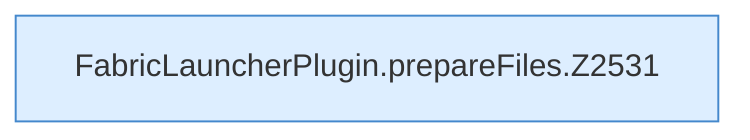

[[00 Start]] › [[Plugin-Kern]] › [[Properties]] › [[FabricLauncherPlugin.prepareFiles]]

# FabricLauncherPlugin.prepareFiles

`FabricLauncherPlugin.prepareFiles(ServerProfile c, Path wd)` [src/main/java/de/aichele/childlauncher/FabricLauncherPlugin.java:2528–2581](https://github.com/Sciddie/minecraft-serverhoster-plugin/blob/95b02b953b0b4c23673e900e021a7c3c844aa37d/src/main/java/de/aichele/childlauncher/FabricLauncherPlugin.java#L2528-L2581)



```knoten
FabricLauncherPlugin.prepareFiles.Z2531
  Der Ablauf geht in [[Glossar#Zeile|Zeile]] 2531 weiter. Eine Ebene tiefer steht er genauer. Im [[Glossar#Quelltext|Quelltext]] heißt das `Z2531`.
```

> [!knoten]- Was die Blöcke tun
> - **FabricLauncherPlugin.prepareFiles.Z2531**: Der Ablauf geht in [[Glossar#Zeile|Zeile]] 2531 weiter. Eine Ebene tiefer steht er genauer. Im [[Glossar#Quelltext|Quelltext]] heißt das `Z2531`.

- Das [[Glossar#Plugin|Plugin]] bereitet vor die Dateien.
