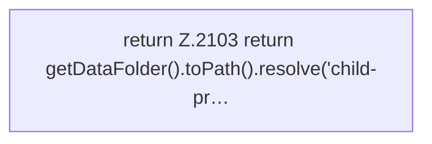

[[00 Start]] › [[Child-Prozess]] › [[Startablauf]] › [[FabricLauncherPlugin.processRecord]]

# FabricLauncherPlugin.processRecord

`FabricLauncherPlugin.processRecord()` [src/main/java/de/aichele/childlauncher/FabricLauncherPlugin.java:2102–2104](https://github.com/Sciddie/minecraft-serverhoster-plugin/blob/95b02b953b0b4c23673e900e021a7c3c844aa37d/src/main/java/de/aichele/childlauncher/FabricLauncherPlugin.java#L2102-L2104)

- `processRecord` in `src/main/java/de/aichele/childlauncher/FabricLauncherPlugin.java`
