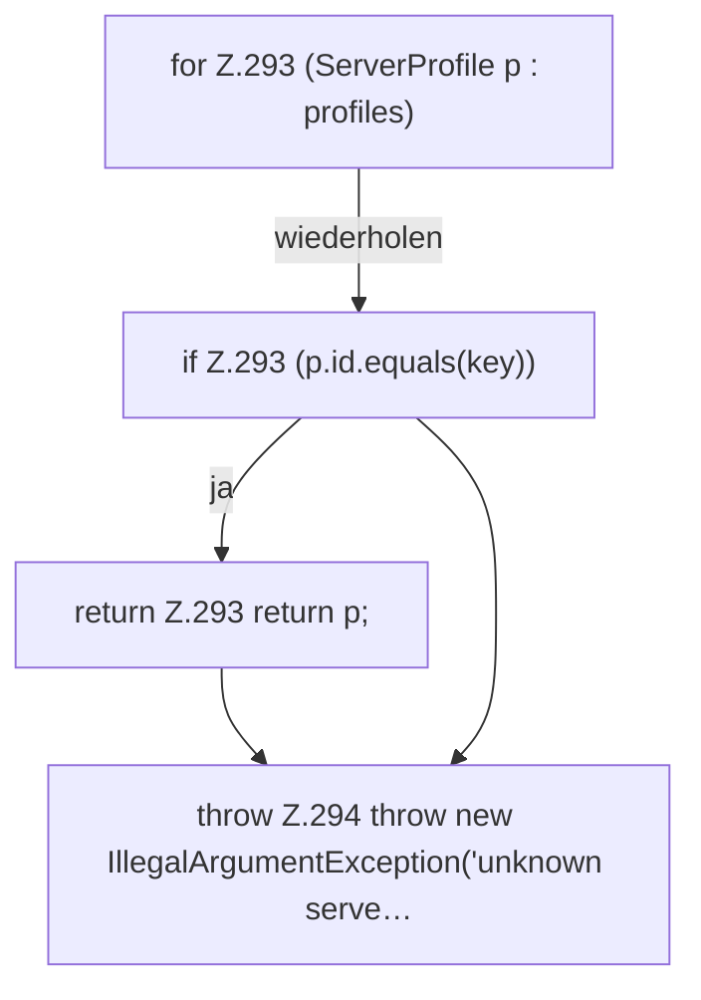

[[00 Start]] › [[Plugin-Kern]] › [[Fokus]] › [[FabricLauncherPlugin.profile]]

# FabricLauncherPlugin.profile

`FabricLauncherPlugin.profile(String id)` [src/main/java/de/aichele/childlauncher/FabricLauncherPlugin.java:291–295](https://github.com/Sciddie/minecraft-serverhoster-plugin/blob/95b02b953b0b4c23673e900e021a7c3c844aa37d/src/main/java/de/aichele/childlauncher/FabricLauncherPlugin.java#L291-L295)

- `profile` in `src/main/java/de/aichele/childlauncher/FabricLauncherPlugin.java`
