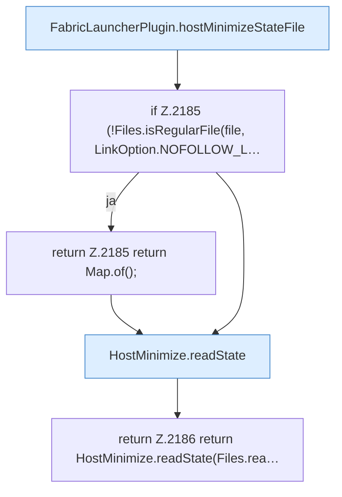

[[00 Start]] › [[Host-Betrieb]] › [[Host-Minimieren]] › [[Host-Minimieren.Teil1]] › [[FabricLauncherPlugin.readHostMinimizeState]]

# FabricLauncherPlugin.readHostMinimizeState

`FabricLauncherPlugin.readHostMinimizeState()` [src/main/java/de/aichele/childlauncher/FabricLauncherPlugin.java:2183–2187](https://github.com/Sciddie/minecraft-serverhoster-plugin/blob/95b02b953b0b4c23673e900e021a7c3c844aa37d/src/main/java/de/aichele/childlauncher/FabricLauncherPlugin.java#L2183-L2187)

- `readHostMinimizeState` in `src/main/java/de/aichele/childlauncher/FabricLauncherPlugin.java`
