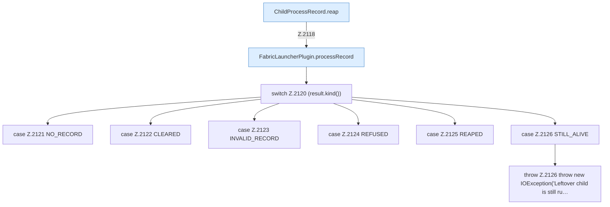

[[00 Start]] › [[Child-Prozess]] › [[Startablauf]] › [[FabricLauncherPlugin.reapLeftover]]

# FabricLauncherPlugin.reapLeftover

`FabricLauncherPlugin.reapLeftover()` [src/main/java/de/aichele/childlauncher/FabricLauncherPlugin.java:2117–2128](https://github.com/Sciddie/minecraft-serverhoster-plugin/blob/95b02b953b0b4c23673e900e021a7c3c844aa37d/src/main/java/de/aichele/childlauncher/FabricLauncherPlugin.java#L2117-L2128)



```knoten
ChildProcessRecord.reap
  Räumt übrige Prozesse ab `reap`. Ruft `read`, `ours`, `waitUntilDead`.
FabricLauncherPlugin.processRecord
  `processRecord` in `FabricLauncherPlugin.java`.
switch Z.2120 (result.kind())
  Zeile 2120: Verzweigung nach `(result.kind())`.
case Z.2121 NO_RECORD
  Zeile 2121: Zweig `NO_RECORD`.
case Z.2122 CLEARED
  Zeile 2122: Zweig `CLEARED`.
case Z.2123 INVALID_RECORD
  Zeile 2123: Zweig `INVALID_RECORD`.
case Z.2124 REFUSED
  Zeile 2124: Zweig `REFUSED`.
case Z.2125 REAPED
  Zeile 2125: Zweig `REAPED`.
case Z.2126 STILL_ALIVE
  Zeile 2126: Zweig `STILL_ALIVE`.
throw Z.2126 throw new IOException('Leftover child is still ru…
  Zeile 2126: Abbruch `throw new IOException('Leftover child is still ru…`.
```

- `reapLeftover` in `src/main/java/de/aichele/childlauncher/FabricLauncherPlugin.java`
