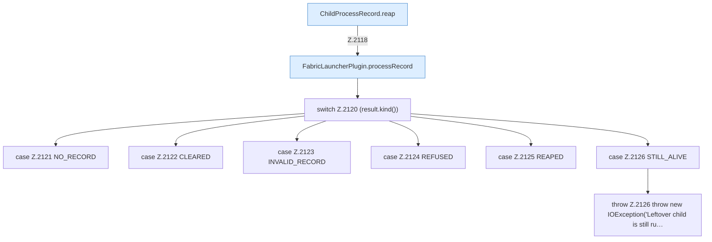

[[00 Start]] › [[Child-Prozess]] › [[Startablauf]] › [[FabricLauncherPlugin.reapLeftover]]

# FabricLauncherPlugin.reapLeftover

`FabricLauncherPlugin.reapLeftover()` [src/main/java/de/aichele/childlauncher/FabricLauncherPlugin.java:2117–2128](https://github.com/Sciddie/minecraft-serverhoster-plugin/blob/95b02b953b0b4c23673e900e021a7c3c844aa37d/src/main/java/de/aichele/childlauncher/FabricLauncherPlugin.java#L2117-L2128)



```knoten
ChildProcessRecord.reap
  Dieser Teil räumt weg das. Im [[Glossar#Quelltext|Quelltext]] heißt das `reap`.
FabricLauncherPlugin.processRecord
  Baut den Merkzettel zum Programm: Nummer und die Prüfungen, ob es noch lebt. Im [[Glossar#Quelltext|Quelltext]] heißt das `processRecord`.
switch Z.2120 (result.kind())
  Hier gibt es mehrere Wege. Einer davon wird gewählt. Das steht in [[Glossar#Zeile|Zeile]] 2120.
case Z.2121 NO_RECORD
  Einer dieser Wege. Das steht in [[Glossar#Zeile|Zeile]] 2121.
case Z.2122 CLEARED
  Einer dieser Wege. Das steht in [[Glossar#Zeile|Zeile]] 2122.
case Z.2123 INVALID_RECORD
  Einer dieser Wege. Das steht in [[Glossar#Zeile|Zeile]] 2123.
case Z.2124 REFUSED
  Einer dieser Wege. Das steht in [[Glossar#Zeile|Zeile]] 2124.
case Z.2125 REAPED
  Einer dieser Wege. Das steht in [[Glossar#Zeile|Zeile]] 2125.
case Z.2126 STILL_ALIVE
  Einer dieser Wege. Das steht in [[Glossar#Zeile|Zeile]] 2126.
throw Z.2126 throw new IOException('Leftover child is still ru…
  Hier bricht die [[Glossar#Funktion|Funktion]] ab, weil etwas nicht geklappt hat. Das steht in [[Glossar#Zeile|Zeile]] 2126.
```

> [!knoten]- Was die Blöcke tun
> - **ChildProcessRecord.reap**: Dieser Teil räumt weg das. Im [[Glossar#Quelltext|Quelltext]] heißt das `reap`.
> - **FabricLauncherPlugin.processRecord**: Baut den Merkzettel zum Programm: Nummer und die Prüfungen, ob es noch lebt. Im [[Glossar#Quelltext|Quelltext]] heißt das `processRecord`.
> - **switch Z.2120 (result.kind())**: Hier gibt es mehrere Wege. Einer davon wird gewählt. Das steht in [[Glossar#Zeile|Zeile]] 2120.
> - **case Z.2121 NO_RECORD**: Einer dieser Wege. Das steht in [[Glossar#Zeile|Zeile]] 2121.
> - **case Z.2122 CLEARED**: Einer dieser Wege. Das steht in [[Glossar#Zeile|Zeile]] 2122.
> - **case Z.2123 INVALID_RECORD**: Einer dieser Wege. Das steht in [[Glossar#Zeile|Zeile]] 2123.
> - **case Z.2124 REFUSED**: Einer dieser Wege. Das steht in [[Glossar#Zeile|Zeile]] 2124.
> - **case Z.2125 REAPED**: Einer dieser Wege. Das steht in [[Glossar#Zeile|Zeile]] 2125.
> - **case Z.2126 STILL_ALIVE**: Einer dieser Wege. Das steht in [[Glossar#Zeile|Zeile]] 2126.
> - **throw Z.2126 throw new IOException('Leftover child is still ru…**: Hier bricht die [[Glossar#Funktion|Funktion]] ab, weil etwas nicht geklappt hat. Das steht in [[Glossar#Zeile|Zeile]] 2126.

- Beendet ein Programm, das von einem früheren Start noch übrig ist.
