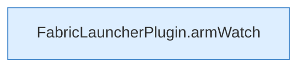

[[00 Start]] › [[Child-Prozess]] › [[Pipe-Watch]] › [[FabricLauncherPlugin.recoverChildSupervision]] › [[FabricLauncherPlugin.recoverChildSupervision.Z2028.Z2034.Case2035]]

# FabricLauncherPlugin.recoverChildSupervision.Z2028.Z2034.Case2035



```knoten
FabricLauncherPlugin.armWatch
  Schaltet die [[Glossar#Aufsicht|Aufsicht]] an, die merkt, wenn das Programm endet. Hängt die Überwachung an `armWatch`. Ruft `watch`.
```

> [!knoten]- Was die Blöcke tun
> - **FabricLauncherPlugin.armWatch**: Schaltet die [[Glossar#Aufsicht|Aufsicht]] an, die merkt, wenn das Programm endet. Hängt die Überwachung an `armWatch`. Ruft `watch`.

- Das Innere eines Wegs, ab [[Glossar#Zeile|Zeile]] 2035.
- Fortsetzung von `FabricLauncherPlugin.recoverChildSupervision.Z2028.Z2034`.
