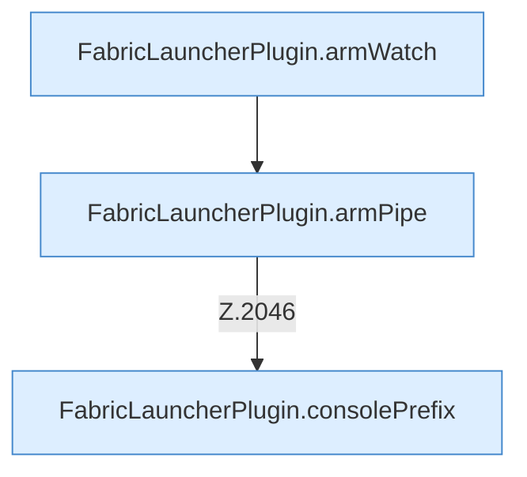

[[00 Start]] › [[Child-Prozess]] › [[Pipe-Watch]] › [[FabricLauncherPlugin.recoverChildSupervision]] › [[FabricLauncherPlugin.recoverChildSupervision.Z2028.Z2034.Case2043]]

# FabricLauncherPlugin.recoverChildSupervision.Z2028.Z2034.Case2043



```knoten
FabricLauncherPlugin.armWatch
  Schaltet die [[Glossar#Aufsicht|Aufsicht]] an, die merkt, wenn das Programm endet. Hängt die Überwachung an `armWatch`. Ruft `watch`.
FabricLauncherPlugin.armPipe
  Schaltet das Mitlesen der [[Glossar#Konsole|Konsole]] an. Hängt die Überwachung an `armPipe`. Ruft `pipe`.
FabricLauncherPlugin.consolePrefix
  Setzt eine kurze Kennung vor jede [[Glossar#Zeile|Zeile]], damit man sie dem [[Glossar#Spielserver|Spielserver]] zuordnen kann. Liefert die [[Glossar#Konsole|Konsole]] `consolePrefix`.
```

> [!knoten]- Was die Blöcke tun
> - **FabricLauncherPlugin.armWatch**: Schaltet die [[Glossar#Aufsicht|Aufsicht]] an, die merkt, wenn das Programm endet. Hängt die Überwachung an `armWatch`. Ruft `watch`.
> - **FabricLauncherPlugin.armPipe**: Schaltet das Mitlesen der [[Glossar#Konsole|Konsole]] an. Hängt die Überwachung an `armPipe`. Ruft `pipe`.
> - **FabricLauncherPlugin.consolePrefix**: Setzt eine kurze Kennung vor jede [[Glossar#Zeile|Zeile]], damit man sie dem [[Glossar#Spielserver|Spielserver]] zuordnen kann. Liefert die [[Glossar#Konsole|Konsole]] `consolePrefix`.

- Das Innere eines Wegs, ab [[Glossar#Zeile|Zeile]] 2043.
- Fortsetzung von `FabricLauncherPlugin.recoverChildSupervision.Z2028.Z2034`.
