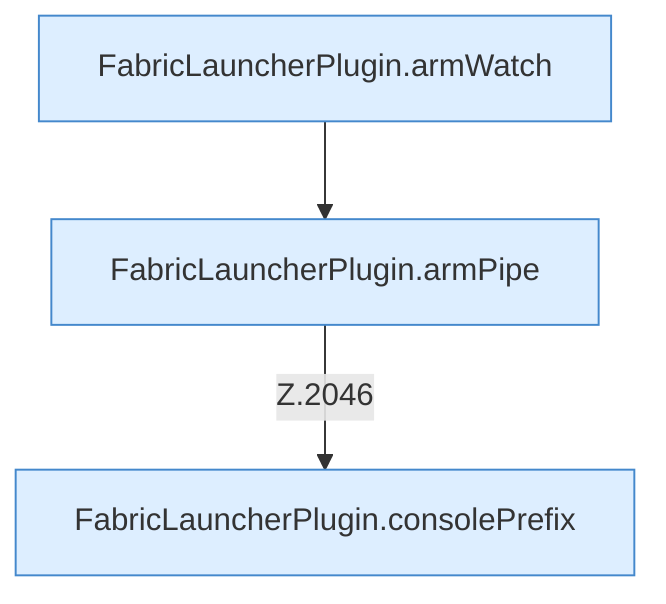

[[00 Start]] › [[Child-Prozess]] › [[Pipe-Watch]] › [[FabricLauncherPlugin.recoverChildSupervision]] › [[FabricLauncherPlugin.recoverChildSupervision.Z2028.Z2034.Case2043]]

# FabricLauncherPlugin.recoverChildSupervision.Z2028.Z2034.Case2043



```knoten
FabricLauncherPlugin.armWatch
  Hängt die Überwachung an `armWatch`. Ruft `watch`.
FabricLauncherPlugin.armPipe
  Hängt die Überwachung an `armPipe`. Ruft `pipe`.
FabricLauncherPlugin.consolePrefix
  Liefert die Konsole `consolePrefix`.
```

- Fortsetzung von `FabricLauncherPlugin.recoverChildSupervision.Z2028.Z2034`, Quellreihenfolge.
