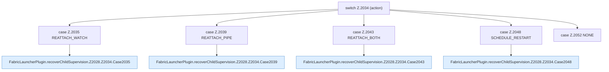

[[00 Start]] › [[Child-Prozess]] › [[Pipe-Watch]] › [[FabricLauncherPlugin.recoverChildSupervision]] › [[FabricLauncherPlugin.recoverChildSupervision.Z2028.Z2034]]

# FabricLauncherPlugin.recoverChildSupervision.Z2028.Z2034

- Fortsetzung von `FabricLauncherPlugin.recoverChildSupervision.Z2028`, Quellreihenfolge.
