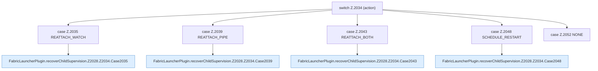

[[00 Start]] › [[Child-Prozess]] › [[Pipe-Watch]] › [[FabricLauncherPlugin.recoverChildSupervision]] › [[FabricLauncherPlugin.recoverChildSupervision.Z2028.Z2034]]

# FabricLauncherPlugin.recoverChildSupervision.Z2028.Z2034



```knoten
switch Z.2034 (action)
  Zeile 2034: Verzweigung nach `(action)`.
case Z.2035 REATTACH_WATCH
  Zeile 2035: Zweig `REATTACH_WATCH`.
FabricLauncherPlugin.recoverChildSupervision.Z2028.Z2034.Case2035
  Das Innere eines Wegs, ab [[Glossar#Zeile|Zeile]] 2035. Rumpf dieses switch-Zweigs ab Zeile 2035.
case Z.2039 REATTACH_PIPE
  Zeile 2039: Zweig `REATTACH_PIPE`.
FabricLauncherPlugin.recoverChildSupervision.Z2028.Z2034.Case2039
  Das Innere eines Wegs, ab [[Glossar#Zeile|Zeile]] 2039. Rumpf dieses switch-Zweigs ab Zeile 2039.
case Z.2043 REATTACH_BOTH
  Zeile 2043: Zweig `REATTACH_BOTH`.
FabricLauncherPlugin.recoverChildSupervision.Z2028.Z2034.Case2043
  Das Innere eines Wegs, ab [[Glossar#Zeile|Zeile]] 2043. Rumpf dieses switch-Zweigs ab Zeile 2043.
case Z.2048 SCHEDULE_RESTART
  Zeile 2048: Zweig `SCHEDULE_RESTART`.
FabricLauncherPlugin.recoverChildSupervision.Z2028.Z2034.Case2048
  Das Innere eines Wegs, ab [[Glossar#Zeile|Zeile]] 2048. Rumpf dieses switch-Zweigs ab Zeile 2048.
case Z.2052 NONE
  Zeile 2052: Zweig `NONE`.
```

> [!knoten]- Was die Blöcke tun
> - **switch Z.2034 (action)**: Zeile 2034: Verzweigung nach `(action)`.
> - **case Z.2035 REATTACH_WATCH**: Zeile 2035: Zweig `REATTACH_WATCH`.
> - **FabricLauncherPlugin.recoverChildSupervision.Z2028.Z2034.Case2035**: Das Innere eines Wegs, ab [[Glossar#Zeile|Zeile]] 2035. Rumpf dieses switch-Zweigs ab Zeile 2035.
> - **case Z.2039 REATTACH_PIPE**: Zeile 2039: Zweig `REATTACH_PIPE`.
> - **FabricLauncherPlugin.recoverChildSupervision.Z2028.Z2034.Case2039**: Das Innere eines Wegs, ab [[Glossar#Zeile|Zeile]] 2039. Rumpf dieses switch-Zweigs ab Zeile 2039.
> - **case Z.2043 REATTACH_BOTH**: Zeile 2043: Zweig `REATTACH_BOTH`.
> - **FabricLauncherPlugin.recoverChildSupervision.Z2028.Z2034.Case2043**: Das Innere eines Wegs, ab [[Glossar#Zeile|Zeile]] 2043. Rumpf dieses switch-Zweigs ab Zeile 2043.
> - **case Z.2048 SCHEDULE_RESTART**: Zeile 2048: Zweig `SCHEDULE_RESTART`.
> - **FabricLauncherPlugin.recoverChildSupervision.Z2028.Z2034.Case2048**: Das Innere eines Wegs, ab [[Glossar#Zeile|Zeile]] 2048. Rumpf dieses switch-Zweigs ab Zeile 2048.
> - **case Z.2052 NONE**: Zeile 2052: Zweig `NONE`.

- Der Ablauf geht in [[Glossar#Zeile|Zeile]] 2034 weiter. Eine Ebene tiefer steht er genauer.
- Fortsetzung von `FabricLauncherPlugin.recoverChildSupervision.Z2028`.
