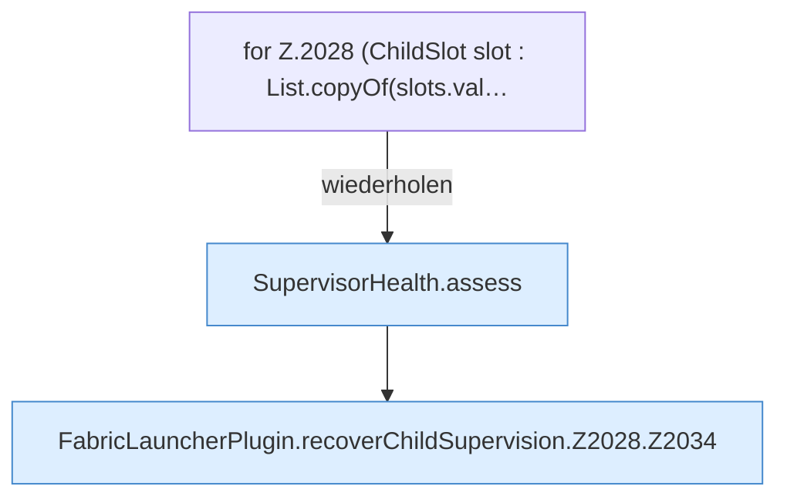

[[00 Start]] › [[Child-Prozess]] › [[Pipe-Watch]] › [[FabricLauncherPlugin.recoverChildSupervision]] › [[FabricLauncherPlugin.recoverChildSupervision.Z2028]]

# FabricLauncherPlugin.recoverChildSupervision.Z2028



```knoten
for Z.2028 (ChildSlot slot : List.copyOf(slots.val…
  Zeile 2028: Schleife `(ChildSlot slot : List.copyOf(slots.val…`.
SupervisorHealth.assess
  Bewertet `assess`.
FabricLauncherPlugin.recoverChildSupervision.Z2028.Z2034
  Fortsetzung des Ablaufs ab Zeile 2034.
```

- Fortsetzung von `FabricLauncherPlugin.recoverChildSupervision`, Quellreihenfolge.
