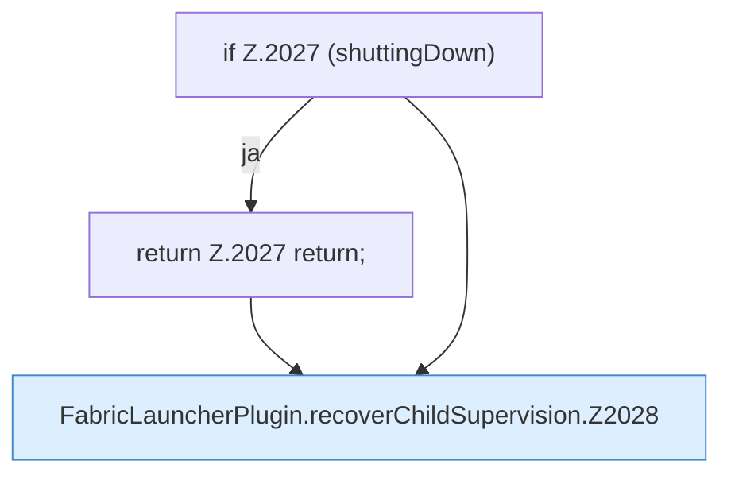

[[00 Start]] › [[Child-Prozess]] › [[Pipe-Watch]] › [[FabricLauncherPlugin.recoverChildSupervision]]

# FabricLauncherPlugin.recoverChildSupervision

`FabricLauncherPlugin.recoverChildSupervision()` [src/main/java/de/aichele/childlauncher/FabricLauncherPlugin.java:2026–2055](https://github.com/Sciddie/minecraft-serverhoster-plugin/blob/95b02b953b0b4c23673e900e021a7c3c844aa37d/src/main/java/de/aichele/childlauncher/FabricLauncherPlugin.java#L2026-L2055)



```knoten
if Z.2027 (shuttingDown)
  Hier fällt eine Entscheidung. Nur wenn sie zutrifft, geht es den Ja-Weg weiter. Das steht in [[Glossar#Zeile|Zeile]] 2027.
return Z.2027 return;
  Hier endet die [[Glossar#Funktion|Funktion]] und liefert ein Ergebnis zurück. Das steht in [[Glossar#Zeile|Zeile]] 2027.
FabricLauncherPlugin.recoverChildSupervision.Z2028
  Der Ablauf geht in [[Glossar#Zeile|Zeile]] 2028 weiter. Eine Ebene tiefer steht er genauer. Im [[Glossar#Quelltext|Quelltext]] heißt das `Z2028`.
```

> [!knoten]- Was die Blöcke tun
> - **if Z.2027 (shuttingDown)**: Hier fällt eine Entscheidung. Nur wenn sie zutrifft, geht es den Ja-Weg weiter. Das steht in [[Glossar#Zeile|Zeile]] 2027.
> - **return Z.2027 return;**: Hier endet die [[Glossar#Funktion|Funktion]] und liefert ein Ergebnis zurück. Das steht in [[Glossar#Zeile|Zeile]] 2027.
> - **FabricLauncherPlugin.recoverChildSupervision.Z2028**: Der Ablauf geht in [[Glossar#Zeile|Zeile]] 2028 weiter. Eine Ebene tiefer steht er genauer. Im [[Glossar#Quelltext|Quelltext]] heißt das `Z2028`.

- Ein [[Glossar#Wecker|Wecker]] alle fünf Sekunden. Er hebt Zustände auf, die hängen geblieben sind, zum Beispiel „startet“, obwohl nichts mehr läuft.
