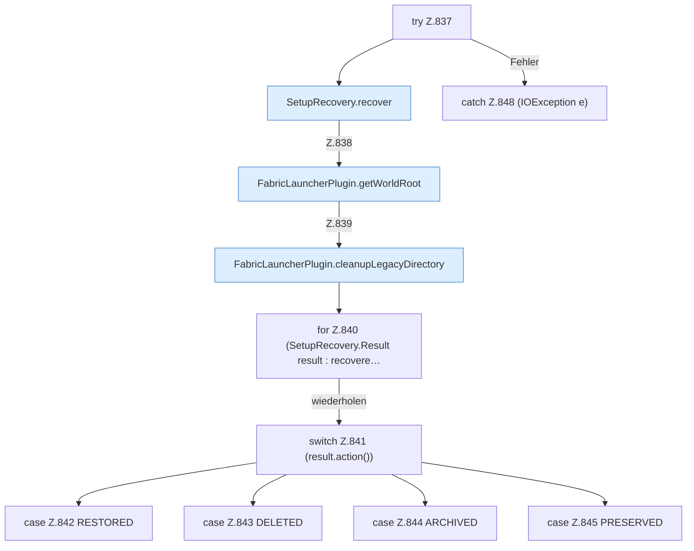

[[00 Start]] › [[Plugin-Kern]] › [[Setup]] › [[Setup-Import]] › [[FabricLauncherPlugin.recoverPendingSetupDirectories]] › [[FabricLauncherPlugin.recoverPendingSetupDirectories.Z837]]

# FabricLauncherPlugin.recoverPendingSetupDirectories.Z837

- Fortsetzung von `FabricLauncherPlugin.recoverPendingSetupDirectories`, Quellreihenfolge.
