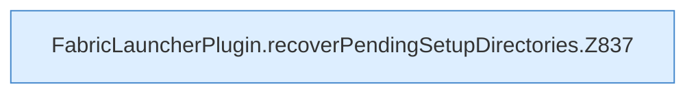

[[00 Start]] › [[Plugin-Kern]] › [[Setup]] › [[Setup-Import]] › [[FabricLauncherPlugin.recoverPendingSetupDirectories]]

# FabricLauncherPlugin.recoverPendingSetupDirectories

`FabricLauncherPlugin.recoverPendingSetupDirectories()` [src/main/java/de/aichele/childlauncher/FabricLauncherPlugin.java:836–851](https://github.com/Sciddie/minecraft-serverhoster-plugin/blob/95b02b953b0b4c23673e900e021a7c3c844aa37d/src/main/java/de/aichele/childlauncher/FabricLauncherPlugin.java#L836-L851)

- `recoverPendingSetupDirectories` in `src/main/java/de/aichele/childlauncher/FabricLauncherPlugin.java`
