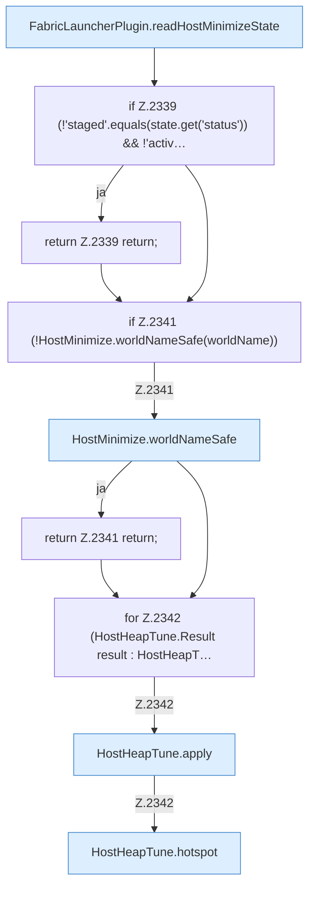

[[00 Start]] › [[Host-Betrieb]] › [[Host-Minimieren]] › [[Host-Minimieren.Teil2]] › [[FabricLauncherPlugin.refreshHostMinimize]] › [[FabricLauncherPlugin.refreshHostMinimize.Z2337.Teil1]]

# FabricLauncherPlugin.refreshHostMinimize.Z2337.Teil1



```knoten
FabricLauncherPlugin.readHostMinimizeState
  Das [[Glossar#Plugin|Plugin]] liest den [[Glossar#Host|Host]] das Verkleinern den Zustand. Liest `readHostMinimizeState`. Ruft `hostMinimizeStateFile`, `readState`.
if Z.2339 (!'staged'.equals(state.get('status')) && !'activ…
  Zeile 2339: prüft `(!'staged'.equals(state.get('status')) && !'activ…`.
return Z.2339 return;
  Zeile 2339: Rückgabe `return;`.
if Z.2341 (!HostMinimize.worldNameSafe(worldName))
  Zeile 2341: prüft `(!HostMinimize.worldNameSafe(worldName))`.
HostMinimize.worldNameSafe
  Das Verkleinern des [[Glossar#Host|Host]] kümmert sich um den Namen die erlaubte Grenze. Betrifft die Welt `worldNameSafe`.
return Z.2341 return;
  Zeile 2341: Rückgabe `return;`.
for Z.2342 (HostHeapTune.Result result : HostHeapT…
  Zeile 2342: Schleife `(HostHeapTune.Result result : HostHeapT…`.
HostHeapTune.apply
  Dieser Teil wendet an das. Wendet an `apply`.
HostHeapTune.hotspot
  Dieser Teil macht hier einen einzelnen Schritt. Eine Ebene tiefer steht er genauer. `hotspot` in `HostHeapTune.java`. Ruft `manageable`, `get`, `set`.
```

> [!knoten]- Was die Blöcke tun
> - **FabricLauncherPlugin.readHostMinimizeState**: Das [[Glossar#Plugin|Plugin]] liest den [[Glossar#Host|Host]] das Verkleinern den Zustand. Liest `readHostMinimizeState`. Ruft `hostMinimizeStateFile`, `readState`.
> - **if Z.2339 (!'staged'.equals(state.get('status')) && !'activ…**: Zeile 2339: prüft `(!'staged'.equals(state.get('status')) && !'activ…`.
> - **return Z.2339 return;**: Zeile 2339: Rückgabe `return;`.
> - **if Z.2341 (!HostMinimize.worldNameSafe(worldName))**: Zeile 2341: prüft `(!HostMinimize.worldNameSafe(worldName))`.
> - **HostMinimize.worldNameSafe**: Das Verkleinern des [[Glossar#Host|Host]] kümmert sich um den Namen die erlaubte Grenze. Betrifft die Welt `worldNameSafe`.
> - **return Z.2341 return;**: Zeile 2341: Rückgabe `return;`.
> - **for Z.2342 (HostHeapTune.Result result : HostHeapT…**: Zeile 2342: Schleife `(HostHeapTune.Result result : HostHeapT…`.
> - **HostHeapTune.apply**: Dieser Teil wendet an das. Wendet an `apply`.
> - **HostHeapTune.hotspot**: Dieser Teil macht hier einen einzelnen Schritt. Eine Ebene tiefer steht er genauer. `hotspot` in `HostHeapTune.java`. Ruft `manageable`, `get`, `set`.

- Ein weiterer Abschnitt derselben Übersicht.
- Fortsetzung von `FabricLauncherPlugin.refreshHostMinimize.Z2337`.
