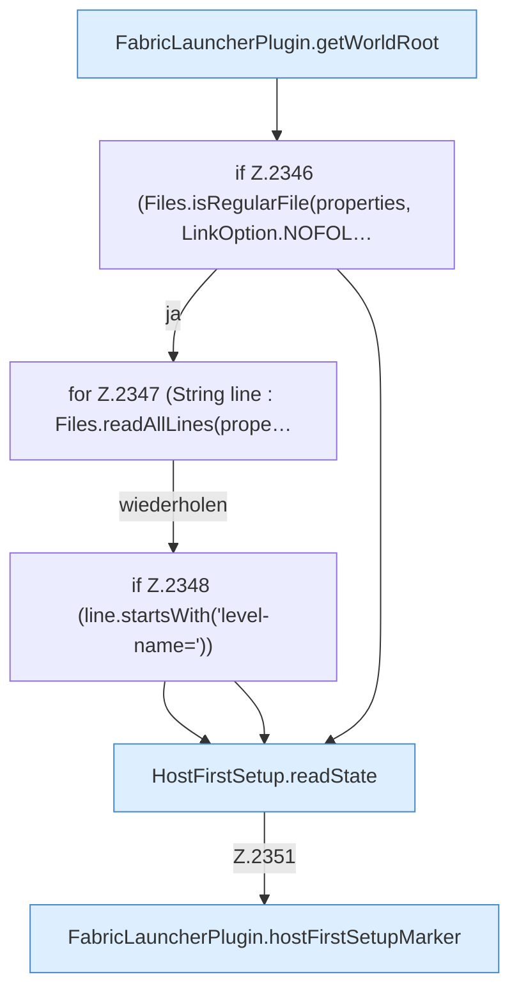

[[00 Start]] › [[Host-Betrieb]] › [[Host-Minimieren]] › [[Host-Minimieren.Teil2]] › [[FabricLauncherPlugin.refreshHostMinimize]] › [[FabricLauncherPlugin.refreshHostMinimize.Z2337.Teil2]]

# FabricLauncherPlugin.refreshHostMinimize.Z2337.Teil2



```knoten
FabricLauncherPlugin.getWorldRoot
  Das [[Glossar#Plugin|Plugin]] liefert die [[Glossar#Spielwelt|Spielwelt]] den Anfang. Liefert `getWorldRoot`.
if Z.2346 (Files.isRegularFile(properties, LinkOption.NOFOL…
  Zeile 2346: prüft `(Files.isRegularFile(properties, LinkOption.NOFOL…`.
for Z.2347 (String line : Files.readAllLines(prope…
  Zeile 2347: Schleife `(String line : Files.readAllLines(prope…`.
if Z.2348 (line.startsWith('level-name='))
  Zeile 2348: prüft `(line.startsWith('level-name='))`.
HostFirstSetup.readState
  Die [[Glossar#Ersteinrichtung|Ersteinrichtung]] liest den Zustand. Liest `readState`. Ruft `readState`.
FabricLauncherPlugin.hostFirstSetupMarker
  Liest oder schreibt die Merkdatei der [[Glossar#Ersteinrichtung|Ersteinrichtung]]. Betrifft den [[Glossar#Host|Host]] `hostFirstSetupMarker`.
```

> [!knoten]- Was die Blöcke tun
> - **FabricLauncherPlugin.getWorldRoot**: Das [[Glossar#Plugin|Plugin]] liefert die [[Glossar#Spielwelt|Spielwelt]] den Anfang. Liefert `getWorldRoot`.
> - **if Z.2346 (Files.isRegularFile(properties, LinkOption.NOFOL…**: Zeile 2346: prüft `(Files.isRegularFile(properties, LinkOption.NOFOL…`.
> - **for Z.2347 (String line : Files.readAllLines(prope…**: Zeile 2347: Schleife `(String line : Files.readAllLines(prope…`.
> - **if Z.2348 (line.startsWith('level-name='))**: Zeile 2348: prüft `(line.startsWith('level-name='))`.
> - **HostFirstSetup.readState**: Die [[Glossar#Ersteinrichtung|Ersteinrichtung]] liest den Zustand. Liest `readState`. Ruft `readState`.
> - **FabricLauncherPlugin.hostFirstSetupMarker**: Liest oder schreibt die Merkdatei der [[Glossar#Ersteinrichtung|Ersteinrichtung]]. Betrifft den [[Glossar#Host|Host]] `hostFirstSetupMarker`.

- Ein weiterer Abschnitt derselben Übersicht.
- Fortsetzung von `FabricLauncherPlugin.refreshHostMinimize.Z2337`.
