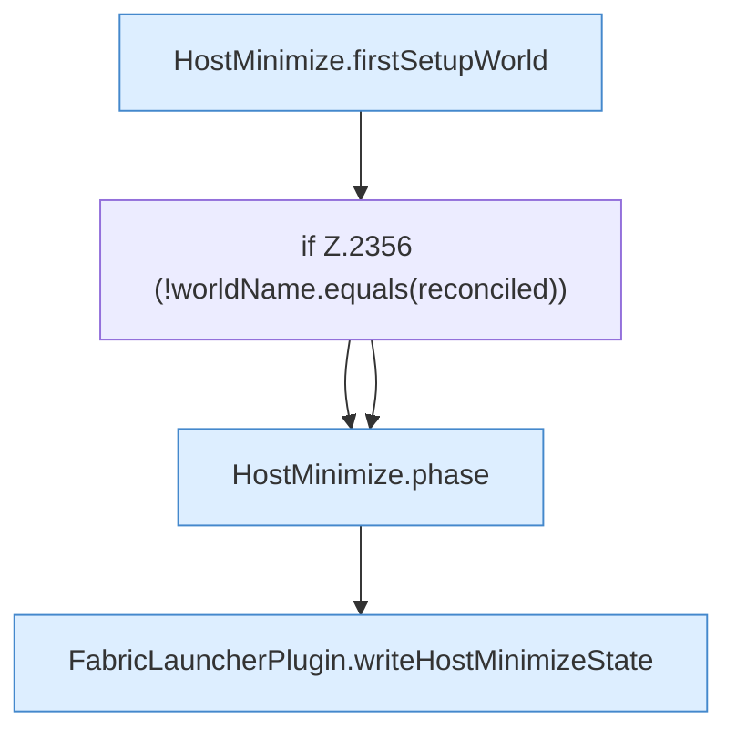

[[00 Start]] › [[Host-Betrieb]] › [[Host-Minimieren]] › [[Host-Minimieren.Teil2]] › [[FabricLauncherPlugin.refreshHostMinimize]] › [[FabricLauncherPlugin.refreshHostMinimize.Z2337.Teil3]]

# FabricLauncherPlugin.refreshHostMinimize.Z2337.Teil3

- Fortsetzung von `FabricLauncherPlugin.refreshHostMinimize.Z2337`, Quellreihenfolge.
