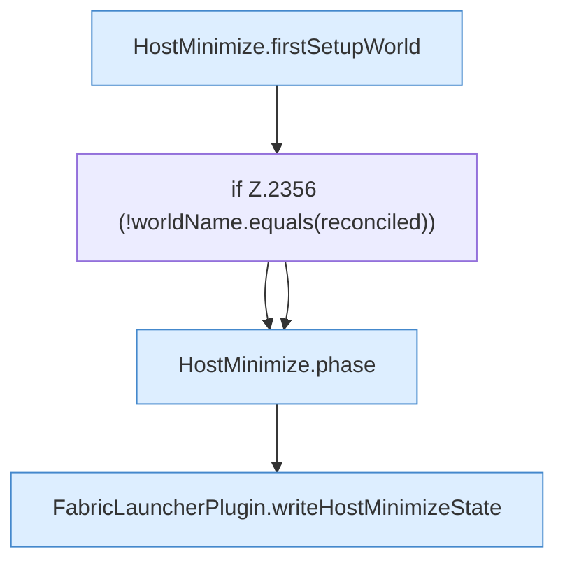

[[00 Start]] › [[Host-Betrieb]] › [[Host-Minimieren]] › [[Host-Minimieren.Teil2]] › [[FabricLauncherPlugin.refreshHostMinimize]] › [[FabricLauncherPlugin.refreshHostMinimize.Z2337.Teil3]]

# FabricLauncherPlugin.refreshHostMinimize.Z2337.Teil3



```knoten
HostMinimize.firstSetupWorld
  Das Verkleinern des [[Glossar#Host|Host]] kümmert sich um die [[Glossar#Einrichtung|Einrichtung]] die [[Glossar#Spielwelt|Spielwelt]]. `firstSetupWorld` in `HostMinimize.java`. Ruft `lobbyNameSafe`.
if Z.2356 (!worldName.equals(reconciled))
  Zeile 2356: prüft `(!worldName.equals(reconciled))`.
HostMinimize.phase
  Das Verkleinern des [[Glossar#Host|Host]] macht hier einen einzelnen Schritt. Eine Ebene tiefer steht er genauer. Liefert die [[Glossar#Phase|Phase]] `phase`. Ruft `worldNameSafe`.
FabricLauncherPlugin.writeHostMinimizeState
  Das [[Glossar#Plugin|Plugin]] schreibt den [[Glossar#Host|Host]] das Verkleinern den Zustand. Schreibt `writeHostMinimizeState`. Ruft `hostMinimizeStateFile`, `stateText`.
```

> [!knoten]- Was die Blöcke tun
> - **HostMinimize.firstSetupWorld**: Das Verkleinern des [[Glossar#Host|Host]] kümmert sich um die [[Glossar#Einrichtung|Einrichtung]] die [[Glossar#Spielwelt|Spielwelt]]. `firstSetupWorld` in `HostMinimize.java`. Ruft `lobbyNameSafe`.
> - **if Z.2356 (!worldName.equals(reconciled))**: Zeile 2356: prüft `(!worldName.equals(reconciled))`.
> - **HostMinimize.phase**: Das Verkleinern des [[Glossar#Host|Host]] macht hier einen einzelnen Schritt. Eine Ebene tiefer steht er genauer. Liefert die [[Glossar#Phase|Phase]] `phase`. Ruft `worldNameSafe`.
> - **FabricLauncherPlugin.writeHostMinimizeState**: Das [[Glossar#Plugin|Plugin]] schreibt den [[Glossar#Host|Host]] das Verkleinern den Zustand. Schreibt `writeHostMinimizeState`. Ruft `hostMinimizeStateFile`, `stateText`.

- Ein weiterer Abschnitt derselben Übersicht.
- Fortsetzung von `FabricLauncherPlugin.refreshHostMinimize.Z2337`.
