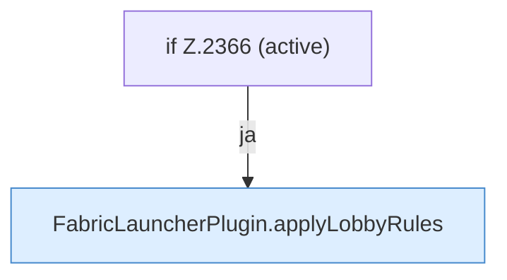

[[00 Start]] › [[Host-Betrieb]] › [[Host-Minimieren]] › [[Host-Minimieren.Teil2]] › [[FabricLauncherPlugin.refreshHostMinimize]] › [[FabricLauncherPlugin.refreshHostMinimize.Z2337.Teil4]]

# FabricLauncherPlugin.refreshHostMinimize.Z2337.Teil4



```knoten
if Z.2366 (active)
  Zeile 2366: prüft `(active)`.
FabricLauncherPlugin.applyLobbyRules
  Das [[Glossar#Plugin|Plugin]] wendet an die Wartewelt. Wendet an `applyLobbyRules`. Ruft `apply`, `name`, `spawnFlags`.
```

> [!knoten]- Was die Blöcke tun
> - **if Z.2366 (active)**: Zeile 2366: prüft `(active)`.
> - **FabricLauncherPlugin.applyLobbyRules**: Das [[Glossar#Plugin|Plugin]] wendet an die Wartewelt. Wendet an `applyLobbyRules`. Ruft `apply`, `name`, `spawnFlags`.

- Ein weiterer Abschnitt derselben Übersicht.
- Fortsetzung von `FabricLauncherPlugin.refreshHostMinimize.Z2337`.
