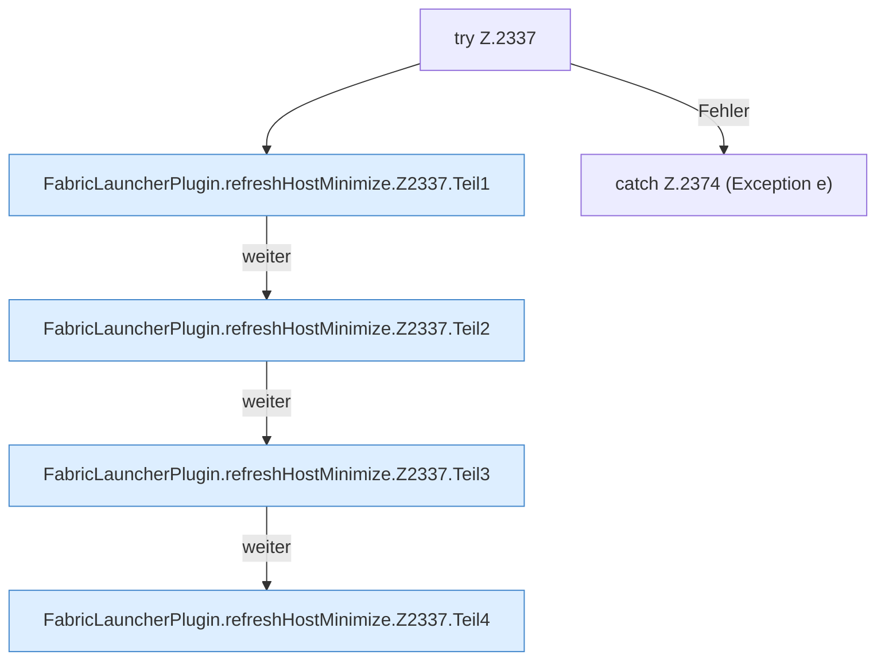

[[00 Start]] › [[Host-Betrieb]] › [[Host-Minimieren]] › [[Host-Minimieren.Teil2]] › [[FabricLauncherPlugin.refreshHostMinimize]] › [[FabricLauncherPlugin.refreshHostMinimize.Z2337]]

# FabricLauncherPlugin.refreshHostMinimize.Z2337



```knoten
try Z.2337
  Zeile 2337: Versuch. Der Fehlerpfad geht in catch.
FabricLauncherPlugin.refreshHostMinimize.Z2337.Teil1
  Ein weiterer Abschnitt derselben Übersicht. Abschnitt 1 dieses Ablaufs, in Quellreihenfolge.
FabricLauncherPlugin.refreshHostMinimize.Z2337.Teil2
  Ein weiterer Abschnitt derselben Übersicht. Abschnitt 2 dieses Ablaufs, in Quellreihenfolge.
FabricLauncherPlugin.refreshHostMinimize.Z2337.Teil3
  Ein weiterer Abschnitt derselben Übersicht. Abschnitt 3 dieses Ablaufs, in Quellreihenfolge.
FabricLauncherPlugin.refreshHostMinimize.Z2337.Teil4
  Ein weiterer Abschnitt derselben Übersicht. Abschnitt 4 dieses Ablaufs, in Quellreihenfolge.
catch Z.2374 (Exception e)
  Zeile 2374: fängt (Exception e).
```

> [!knoten]- Was die Blöcke tun
> - **try Z.2337**: Zeile 2337: Versuch. Der Fehlerpfad geht in catch.
> - **FabricLauncherPlugin.refreshHostMinimize.Z2337.Teil1**: Ein weiterer Abschnitt derselben Übersicht. Abschnitt 1 dieses Ablaufs, in Quellreihenfolge.
> - **FabricLauncherPlugin.refreshHostMinimize.Z2337.Teil2**: Ein weiterer Abschnitt derselben Übersicht. Abschnitt 2 dieses Ablaufs, in Quellreihenfolge.
> - **FabricLauncherPlugin.refreshHostMinimize.Z2337.Teil3**: Ein weiterer Abschnitt derselben Übersicht. Abschnitt 3 dieses Ablaufs, in Quellreihenfolge.
> - **FabricLauncherPlugin.refreshHostMinimize.Z2337.Teil4**: Ein weiterer Abschnitt derselben Übersicht. Abschnitt 4 dieses Ablaufs, in Quellreihenfolge.
> - **catch Z.2374 (Exception e)**: Zeile 2374: fängt (Exception e).

- Der Ablauf geht in [[Glossar#Zeile|Zeile]] 2337 weiter. Eine Ebene tiefer steht er genauer.
- Fortsetzung von `FabricLauncherPlugin.refreshHostMinimize`.
