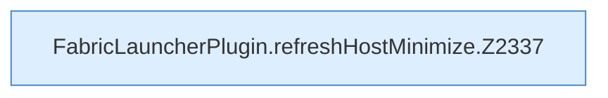

[[00 Start]] › [[Host-Betrieb]] › [[Host-Minimieren]] › [[Host-Minimieren.Teil2]] › [[FabricLauncherPlugin.refreshHostMinimize]]

# FabricLauncherPlugin.refreshHostMinimize

`FabricLauncherPlugin.refreshHostMinimize()` [src/main/java/de/aichele/childlauncher/FabricLauncherPlugin.java:2336–2377](https://github.com/Sciddie/minecraft-serverhoster-plugin/blob/95b02b953b0b4c23673e900e021a7c3c844aa37d/src/main/java/de/aichele/childlauncher/FabricLauncherPlugin.java#L2336-L2377)

- `refreshHostMinimize` in `src/main/java/de/aichele/childlauncher/FabricLauncherPlugin.java`
