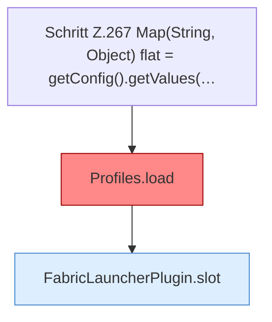

[[00 Start]] › [[Plugin-Kern]] › [[Konfiguration]] › [[FabricLauncherPlugin.reloadProfiles]]

# FabricLauncherPlugin.reloadProfiles

`FabricLauncherPlugin.reloadProfiles()` [src/main/java/de/aichele/childlauncher/FabricLauncherPlugin.java:266–273](https://github.com/Sciddie/minecraft-serverhoster-plugin/blob/95b02b953b0b4c23673e900e021a7c3c844aa37d/src/main/java/de/aichele/childlauncher/FabricLauncherPlugin.java#L266-L273)



```knoten
Schritt Z.267 Map(String, Object) flat = getConfig().getValues(…
  Ein einzelner Arbeitsschritt, ohne eine weitere eigene [[Glossar#Funktion|Funktion]] aufzurufen. Das steht in [[Glossar#Zeile|Zeile]] 267.
Profiles.load
  Die Serverbeschreibung lädt das. Im [[Glossar#Quelltext|Quelltext]] heißt das `load`. Auffällig: es ist vorgesehen, der laufende Weg benutzt es aber nicht. Das nennt man [[Glossar#Nicht benutzt|Nicht benutzt]].
FabricLauncherPlugin.slot
  Das [[Glossar#Plugin|Plugin]] macht hier einen einzelnen Schritt. Eine Ebene tiefer steht er genauer. Im [[Glossar#Quelltext|Quelltext]] heißt das `slot`.
```

> [!knoten]- Was die Blöcke tun
> - **Schritt Z.267 Map(String, Object) flat = getConfig().getValues(…**: Ein einzelner Arbeitsschritt, ohne eine weitere eigene [[Glossar#Funktion|Funktion]] aufzurufen. Das steht in [[Glossar#Zeile|Zeile]] 267.
> - **Profiles.load**: Die Serverbeschreibung lädt das. Im [[Glossar#Quelltext|Quelltext]] heißt das `load`. Auffällig: es ist vorgesehen, der laufende Weg benutzt es aber nicht. Das nennt man [[Glossar#Nicht benutzt|Nicht benutzt]].
> - **FabricLauncherPlugin.slot**: Das [[Glossar#Plugin|Plugin]] macht hier einen einzelnen Schritt. Eine Ebene tiefer steht er genauer. Im [[Glossar#Quelltext|Quelltext]] heißt das `slot`.

- Liest die Server aus den [[Glossar#Einstellungen|Einstellungen]] neu und behält nur den ersten.
- Auffällig: es ist vorgesehen, der laufende Weg benutzt es aber nicht. Das nennt man [[Glossar#Nicht benutzt|Nicht benutzt]].
