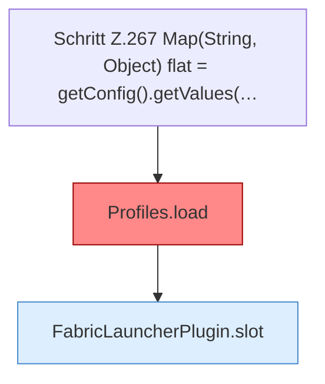

[[00 Start]] › [[Plugin-Kern]] › [[Konfiguration]] › [[FabricLauncherPlugin.reloadProfiles]]

# FabricLauncherPlugin.reloadProfiles

`FabricLauncherPlugin.reloadProfiles()` [src/main/java/de/aichele/childlauncher/FabricLauncherPlugin.java:266–273](https://github.com/Sciddie/minecraft-serverhoster-plugin/blob/95b02b953b0b4c23673e900e021a7c3c844aa37d/src/main/java/de/aichele/childlauncher/FabricLauncherPlugin.java#L266-L273)



```knoten
Schritt Z.267 Map(String, Object) flat = getConfig().getValues(…
  Zeile 267: liest die Config. `Map(String, Object) flat = getConfig().getValues(…`
Profiles.load
  Lädt `load`. Ruft `one`, `str`, `copyId`. Befund: angemeldet aber nicht umgesetzt (sicher).
FabricLauncherPlugin.slot
  `slot` in `FabricLauncherPlugin.java`. Ruft `profile`, `ChildSlot`.
```

- `Profiles.load`, danach nur `getFirst()`.
- Befund: angemeldet aber nicht umgesetzt, sicher. FabricLauncherPlugin.java:266–272 getFirst verwirft servers.*
