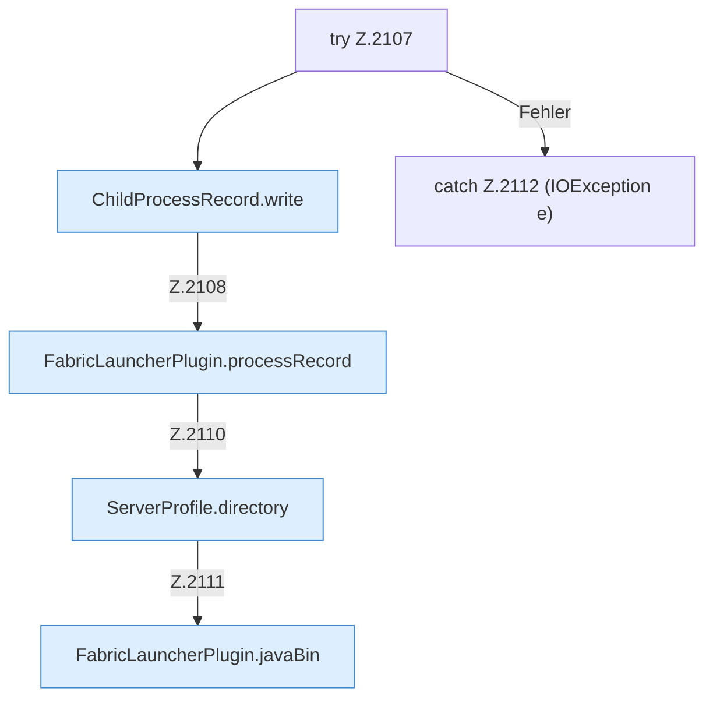

[[00 Start]] › [[Child-Prozess]] › [[Startablauf]] › [[FabricLauncherPlugin.rememberProcess]] › [[FabricLauncherPlugin.rememberProcess.Z2107]]

# FabricLauncherPlugin.rememberProcess.Z2107



```knoten
try Z.2107
  Zeile 2107: Versuch. Der Fehlerpfad geht in catch.
ChildProcessRecord.write
  Schreibt `write`. Ruft `safe`.
FabricLauncherPlugin.processRecord
  `processRecord` in `FabricLauncherPlugin.java`.
ServerProfile.directory
  `directory` in `ServerProfile.java`.
FabricLauncherPlugin.javaBin
  Liefert das Java-Binary `javaBin`. Ruft `isWindows`.
catch Z.2112 (IOException e)
  Zeile 2112: fängt (IOException e).
```

- Fortsetzung von `FabricLauncherPlugin.rememberProcess`, Quellreihenfolge.
