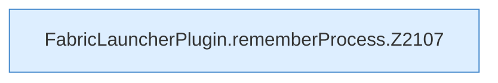

[[00 Start]] › [[Child-Prozess]] › [[Startablauf]] › [[FabricLauncherPlugin.rememberProcess]]

# FabricLauncherPlugin.rememberProcess

`FabricLauncherPlugin.rememberProcess(Process process, ServerProfile profile, Path jar)` [src/main/java/de/aichele/childlauncher/FabricLauncherPlugin.java:2106–2115](https://github.com/Sciddie/minecraft-serverhoster-plugin/blob/95b02b953b0b4c23673e900e021a7c3c844aa37d/src/main/java/de/aichele/childlauncher/FabricLauncherPlugin.java#L2106-L2115)



```knoten
FabricLauncherPlugin.rememberProcess.Z2107
  Fortsetzung des Ablaufs ab Zeile 2107.
```

- `rememberProcess` in `src/main/java/de/aichele/childlauncher/FabricLauncherPlugin.java`
