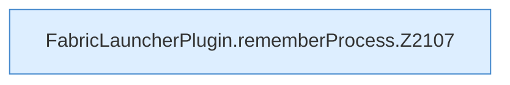

[[00 Start]] › [[Child-Prozess]] › [[Startablauf]] › [[FabricLauncherPlugin.rememberProcess]]

# FabricLauncherPlugin.rememberProcess

`FabricLauncherPlugin.rememberProcess(Process process, ServerProfile profile, Path jar)` [src/main/java/de/aichele/childlauncher/FabricLauncherPlugin.java:2106–2115](https://github.com/Sciddie/minecraft-serverhoster-plugin/blob/95b02b953b0b4c23673e900e021a7c3c844aa37d/src/main/java/de/aichele/childlauncher/FabricLauncherPlugin.java#L2106-L2115)



```knoten
FabricLauncherPlugin.rememberProcess.Z2107
  Der Ablauf geht in [[Glossar#Zeile|Zeile]] 2107 weiter. Eine Ebene tiefer steht er genauer. Im [[Glossar#Quelltext|Quelltext]] heißt das `Z2107`.
```

> [!knoten]- Was die Blöcke tun
> - **FabricLauncherPlugin.rememberProcess.Z2107**: Der Ablauf geht in [[Glossar#Zeile|Zeile]] 2107 weiter. Eine Ebene tiefer steht er genauer. Im [[Glossar#Quelltext|Quelltext]] heißt das `Z2107`.

- Merkt sich Programmnummer und [[Glossar#Programmdatei|Programmdatei]], damit das [[Glossar#Plugin|Plugin]] den [[Glossar#Spielserver|Spielserver]] später wiederfindet.
