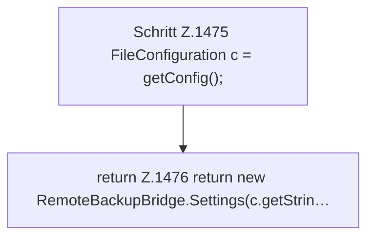

[[00 Start]] › [[Backup]] › [[Backup-Lauf]] › [[FabricLauncherPlugin.remoteBackupSettings]]

# FabricLauncherPlugin.remoteBackupSettings

`FabricLauncherPlugin.remoteBackupSettings()` [src/main/java/de/aichele/childlauncher/FabricLauncherPlugin.java:1474–1479](https://github.com/Sciddie/minecraft-serverhoster-plugin/blob/95b02b953b0b4c23673e900e021a7c3c844aa37d/src/main/java/de/aichele/childlauncher/FabricLauncherPlugin.java#L1474-L1479)



```knoten
Schritt Z.1475 FileConfiguration c = getConfig();
  Ein einzelner Arbeitsschritt, ohne eine weitere eigene [[Glossar#Funktion|Funktion]] aufzurufen. Das steht in [[Glossar#Zeile|Zeile]] 1475.
return Z.1476 return new RemoteBackupBridge.Settings(c.getStrin…
  Hier endet die [[Glossar#Funktion|Funktion]] und liefert ein Ergebnis zurück. Das steht in [[Glossar#Zeile|Zeile]] 1476.
```

> [!knoten]- Was die Blöcke tun
> - **Schritt Z.1475 FileConfiguration c = getConfig();**: Ein einzelner Arbeitsschritt, ohne eine weitere eigene [[Glossar#Funktion|Funktion]] aufzurufen. Das steht in [[Glossar#Zeile|Zeile]] 1475.
> - **return Z.1476 return new RemoteBackupBridge.Settings(c.getStrin…**: Hier endet die [[Glossar#Funktion|Funktion]] und liefert ein Ergebnis zurück. Das steht in [[Glossar#Zeile|Zeile]] 1476.

- Das [[Glossar#Plugin|Plugin]] sichert die [[Glossar#Einstellungen|Einstellungen]].
