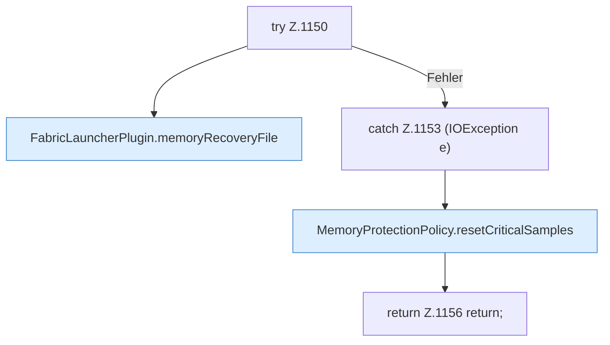

[[00 Start]] › [[Host-Betrieb]] › [[Speicher-Stopp]] › [[FabricLauncherPlugin.requestChildEmergencyStop]] › [[FabricLauncherPlugin.requestChildEmergencyStop.Teil1.Z1150]]

# FabricLauncherPlugin.requestChildEmergencyStop.Teil1.Z1150



```knoten
try Z.1150
  Zeile 1150: Versuch. Der Fehlerpfad geht in catch.
FabricLauncherPlugin.memoryRecoveryFile
  Die Datei, in der steht, ob der Speicher nach einem [[Glossar#Vorfall|Vorfall]] schon wieder freigegeben wurde. Betrifft den Speicher `memoryRecoveryFile`.
catch Z.1153 (IOException e)
  Zeile 1153: fängt (IOException e).
MemoryProtectionPolicy.resetCriticalSamples
  Dieser Teil setzt zurück hier einen Schritt. Eine Ebene tiefer steht er genauer. Setzt zurück `resetCriticalSamples`.
return Z.1156 return;
  Zeile 1156: Rückgabe `return;`.
```

> [!knoten]- Was die Blöcke tun
> - **try Z.1150**: Zeile 1150: Versuch. Der Fehlerpfad geht in catch.
> - **FabricLauncherPlugin.memoryRecoveryFile**: Die Datei, in der steht, ob der Speicher nach einem [[Glossar#Vorfall|Vorfall]] schon wieder freigegeben wurde. Betrifft den Speicher `memoryRecoveryFile`.
> - **catch Z.1153 (IOException e)**: Zeile 1153: fängt (IOException e).
> - **MemoryProtectionPolicy.resetCriticalSamples**: Dieser Teil setzt zurück hier einen Schritt. Eine Ebene tiefer steht er genauer. Setzt zurück `resetCriticalSamples`.
> - **return Z.1156 return;**: Zeile 1156: Rückgabe `return;`.

- Der Ablauf geht in [[Glossar#Zeile|Zeile]] 1150 weiter. Eine Ebene tiefer steht er genauer.
- Fortsetzung von `FabricLauncherPlugin.requestChildEmergencyStop.Teil1`.
