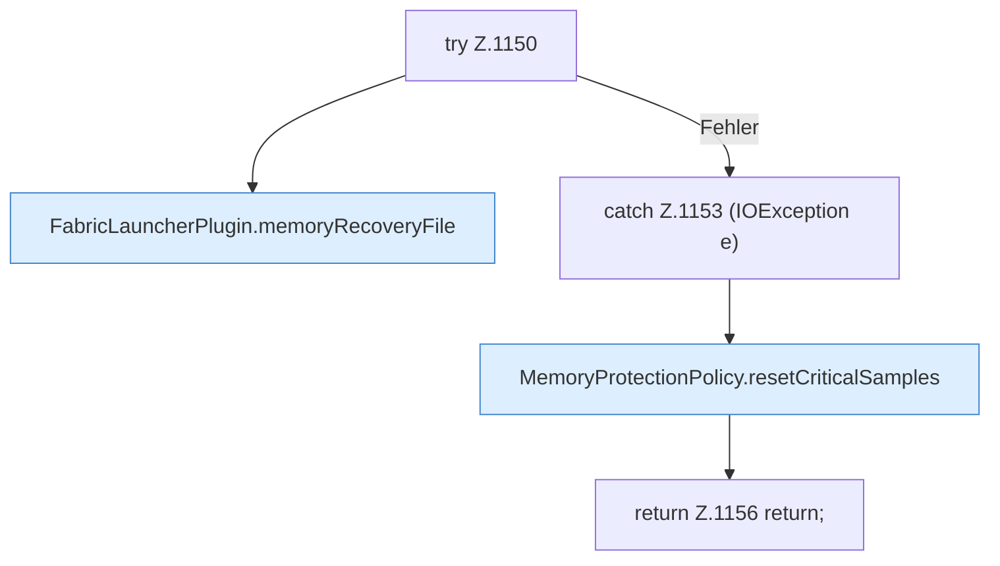

[[00 Start]] › [[Host-Betrieb]] › [[Speicher-Stopp]] › [[FabricLauncherPlugin.requestChildEmergencyStop]] › [[FabricLauncherPlugin.requestChildEmergencyStop.Teil1.Z1150]]

# FabricLauncherPlugin.requestChildEmergencyStop.Teil1.Z1150

- Fortsetzung von `FabricLauncherPlugin.requestChildEmergencyStop.Teil1`, Quellreihenfolge.
