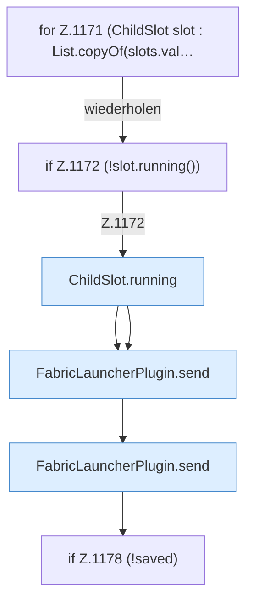

[[00 Start]] › [[Host-Betrieb]] › [[Speicher-Stopp]] › [[FabricLauncherPlugin.requestChildEmergencyStop]] › [[FabricLauncherPlugin.requestChildEmergencyStop.Teil2.Z1171]]

# FabricLauncherPlugin.requestChildEmergencyStop.Teil2.Z1171

- Fortsetzung von `FabricLauncherPlugin.requestChildEmergencyStop.Teil2`, Quellreihenfolge.
