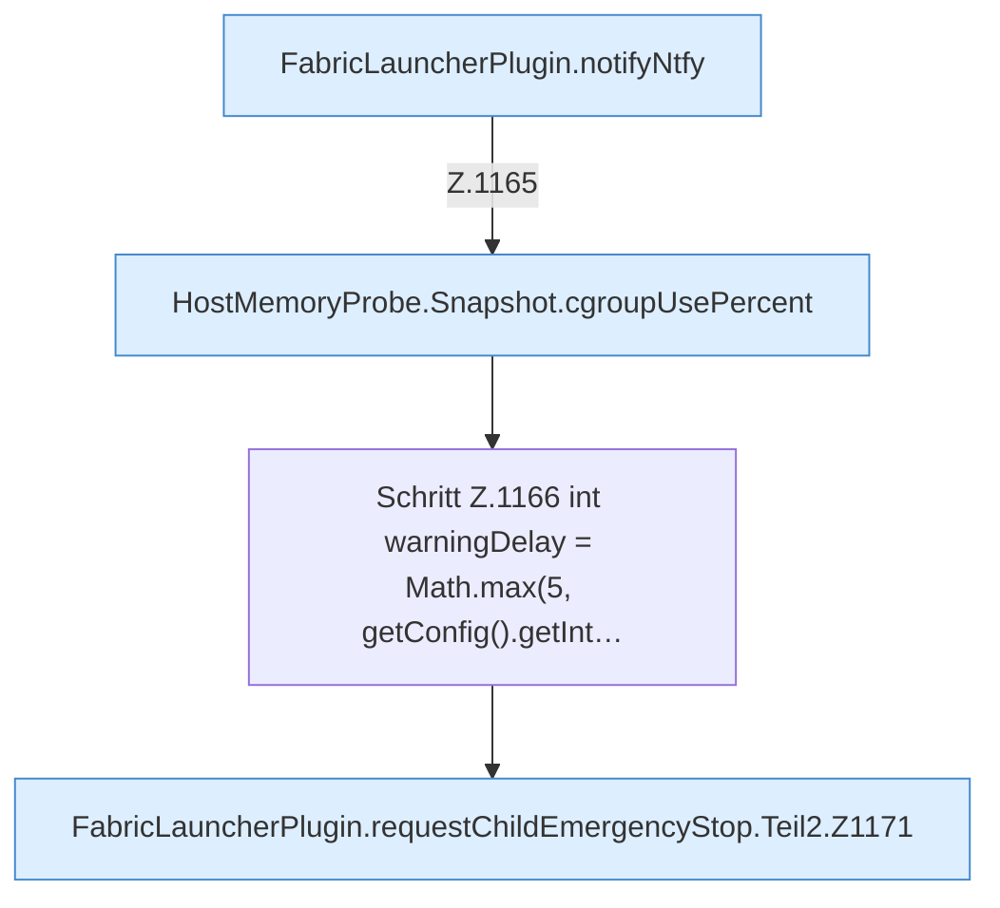

[[00 Start]] › [[Host-Betrieb]] › [[Speicher-Stopp]] › [[FabricLauncherPlugin.requestChildEmergencyStop]] › [[FabricLauncherPlugin.requestChildEmergencyStop.Teil2]]

# FabricLauncherPlugin.requestChildEmergencyStop.Teil2



```knoten
FabricLauncherPlugin.notifyNtfy
  Meldet `notifyNtfy`. Ruft `ntfySettings`, `backupCredentials`, `send`.
HostMemoryProbe.Snapshot.cgroupUsePercent
  `cgroupUsePercent` in `HostMemoryProbe.java`.
Schritt Z.1166 int warningDelay = Math.max(5, getConfig().getInt…
  Zeile 1166: liest die Config. `int warningDelay = Math.max(5, getConfig().getInt…`
FabricLauncherPlugin.requestChildEmergencyStop.Teil2.Z1171
  Fortsetzung des Ablaufs ab Zeile 1171.
```

- Fortsetzung von `FabricLauncherPlugin.requestChildEmergencyStop`, Quellreihenfolge.
