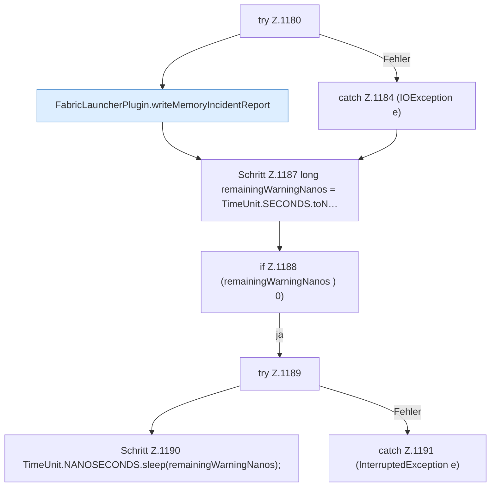

[[00 Start]] › [[Host-Betrieb]] › [[Speicher-Stopp]] › [[FabricLauncherPlugin.requestChildEmergencyStop]] › [[FabricLauncherPlugin.requestChildEmergencyStop.Teil3]]

# FabricLauncherPlugin.requestChildEmergencyStop.Teil3



```knoten
try Z.1180
  Zeile 1180: Versuch. Der Fehlerpfad geht in catch.
FabricLauncherPlugin.writeMemoryIncidentReport
  Das [[Glossar#Plugin|Plugin]] schreibt den [[Glossar#Arbeitsspeicher|Arbeitsspeicher]] den [[Glossar#Vorfall|Vorfall]] den Bericht. Schreibt `writeMemoryIncidentReport`. Ruft `snapshot`, `cgroupUsePercent`, `criticalSamples`.
catch Z.1184 (IOException e)
  Zeile 1184: fängt (IOException e).
Schritt Z.1187 long remainingWarningNanos = TimeUnit.SECONDS.toN…
  Zeile 1187: rechnet Zeit um oder wartet. `long remainingWarningNanos = TimeUnit.SECONDS.toN…`
if Z.1188 (remainingWarningNanos ) 0)
  Zeile 1188: prüft `(remainingWarningNanos ) 0)`.
try Z.1189
  Zeile 1189: Versuch. Der Fehlerpfad geht in catch.
Schritt Z.1190 TimeUnit.NANOSECONDS.sleep(remainingWarningNanos);
  Zeile 1190: rechnet Zeit um oder wartet. `TimeUnit.NANOSECONDS.sleep(remainingWarningNanos);`
catch Z.1191 (InterruptedException e)
  Zeile 1191: fängt (InterruptedException e).
```

> [!knoten]- Was die Blöcke tun
> - **try Z.1180**: Zeile 1180: Versuch. Der Fehlerpfad geht in catch.
> - **FabricLauncherPlugin.writeMemoryIncidentReport**: Das [[Glossar#Plugin|Plugin]] schreibt den [[Glossar#Arbeitsspeicher|Arbeitsspeicher]] den [[Glossar#Vorfall|Vorfall]] den Bericht. Schreibt `writeMemoryIncidentReport`. Ruft `snapshot`, `cgroupUsePercent`, `criticalSamples`.
> - **catch Z.1184 (IOException e)**: Zeile 1184: fängt (IOException e).
> - **Schritt Z.1187 long remainingWarningNanos = TimeUnit.SECONDS.toN…**: Zeile 1187: rechnet Zeit um oder wartet. `long remainingWarningNanos = TimeUnit.SECONDS.toN…`
> - **if Z.1188 (remainingWarningNanos ) 0)**: Zeile 1188: prüft `(remainingWarningNanos ) 0)`.
> - **try Z.1189**: Zeile 1189: Versuch. Der Fehlerpfad geht in catch.
> - **Schritt Z.1190 TimeUnit.NANOSECONDS.sleep(remainingWarningNanos);**: Zeile 1190: rechnet Zeit um oder wartet. `TimeUnit.NANOSECONDS.sleep(remainingWarningNanos);`
> - **catch Z.1191 (InterruptedException e)**: Zeile 1191: fängt (InterruptedException e).

- Ein weiterer Abschnitt derselben Übersicht.
- Fortsetzung von `FabricLauncherPlugin.requestChildEmergencyStop`.
