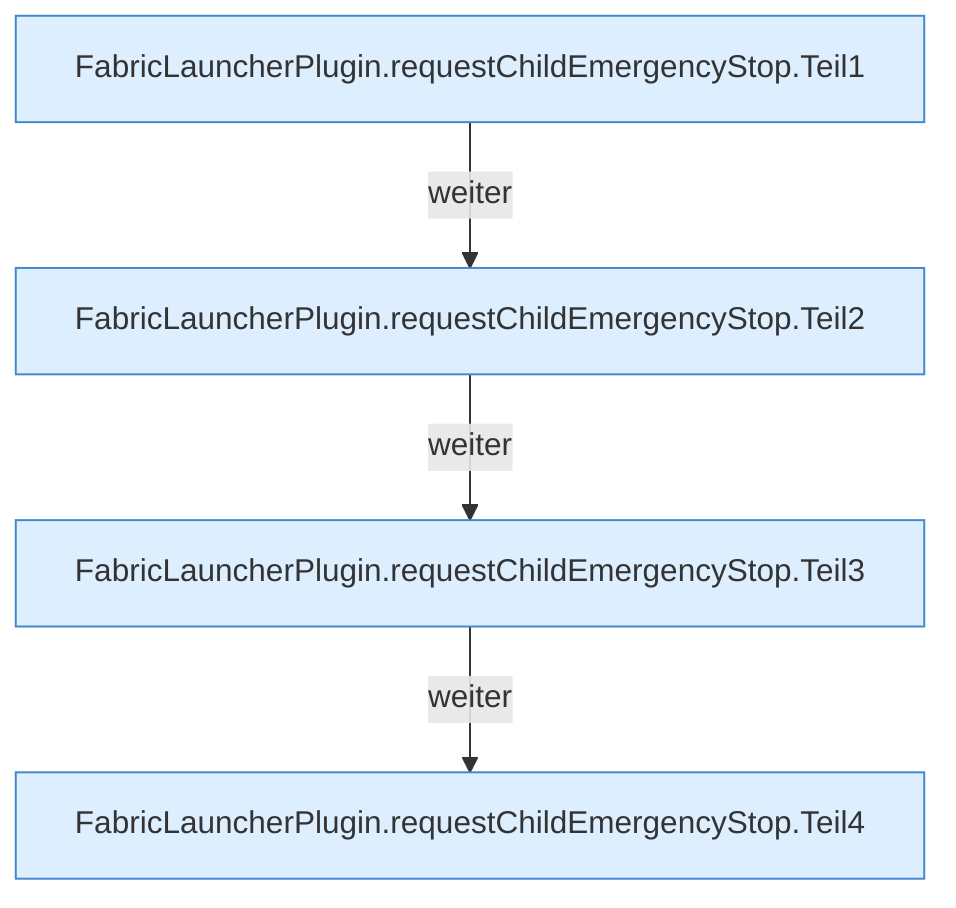

[[00 Start]] › [[Host-Betrieb]] › [[Speicher-Stopp]] › [[FabricLauncherPlugin.requestChildEmergencyStop]]

# FabricLauncherPlugin.requestChildEmergencyStop

`FabricLauncherPlugin.requestChildEmergencyStop(HostMemoryProbe.Snapshot snapshot)` [src/main/java/de/aichele/childlauncher/FabricLauncherPlugin.java:1147–1201](https://github.com/Sciddie/minecraft-serverhoster-plugin/blob/95b02b953b0b4c23673e900e021a7c3c844aa37d/src/main/java/de/aichele/childlauncher/FabricLauncherPlugin.java#L1147-L1201)

- Stoppt den Child. Logtext sagt Emergency restart.
- Befund: Kommentar widerspricht Code, sicher. Z.1175 Emergency restart warning, Z.1197–1199 wantRunning=false und stopBlocking, kein Start
