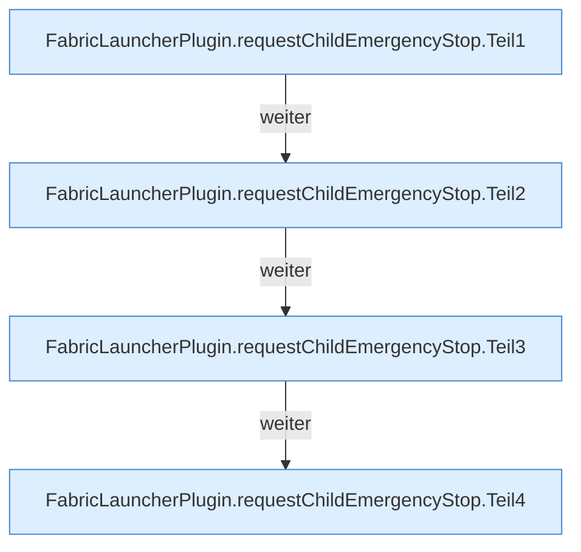

[[00 Start]] › [[Host-Betrieb]] › [[Speicher-Stopp]] › [[FabricLauncherPlugin.requestChildEmergencyStop]]

# FabricLauncherPlugin.requestChildEmergencyStop

`FabricLauncherPlugin.requestChildEmergencyStop(HostMemoryProbe.Snapshot snapshot)` [src/main/java/de/aichele/childlauncher/FabricLauncherPlugin.java:1147–1201](https://github.com/Sciddie/minecraft-serverhoster-plugin/blob/95b02b953b0b4c23673e900e021a7c3c844aa37d/src/main/java/de/aichele/childlauncher/FabricLauncherPlugin.java#L1147-L1201)



```knoten
FabricLauncherPlugin.requestChildEmergencyStop.Teil1
  Ein weiterer Abschnitt derselben Übersicht. Im [[Glossar#Quelltext|Quelltext]] heißt das `Teil1`.
FabricLauncherPlugin.requestChildEmergencyStop.Teil2
  Ein weiterer Abschnitt derselben Übersicht. Im [[Glossar#Quelltext|Quelltext]] heißt das `Teil2`.
FabricLauncherPlugin.requestChildEmergencyStop.Teil3
  Ein weiterer Abschnitt derselben Übersicht. Im [[Glossar#Quelltext|Quelltext]] heißt das `Teil3`.
FabricLauncherPlugin.requestChildEmergencyStop.Teil4
  Ein weiterer Abschnitt derselben Übersicht. Im [[Glossar#Quelltext|Quelltext]] heißt das `Teil4`.
```

> [!knoten]- Was die Blöcke tun
> - **FabricLauncherPlugin.requestChildEmergencyStop.Teil1**: Ein weiterer Abschnitt derselben Übersicht. Im [[Glossar#Quelltext|Quelltext]] heißt das `Teil1`.
> - **FabricLauncherPlugin.requestChildEmergencyStop.Teil2**: Ein weiterer Abschnitt derselben Übersicht. Im [[Glossar#Quelltext|Quelltext]] heißt das `Teil2`.
> - **FabricLauncherPlugin.requestChildEmergencyStop.Teil3**: Ein weiterer Abschnitt derselben Übersicht. Im [[Glossar#Quelltext|Quelltext]] heißt das `Teil3`.
> - **FabricLauncherPlugin.requestChildEmergencyStop.Teil4**: Ein weiterer Abschnitt derselben Übersicht. Im [[Glossar#Quelltext|Quelltext]] heißt das `Teil4`.

- Schaltet den [[Glossar#Spielserver|Spielserver]] wegen Speichermangels aus. Die Meldung spricht von einem [[Glossar#Neustart|Neustart]], neu gestartet wird nicht.
- Auffällig: ein Kommentar oder eine Meldung sagt etwas anderes als der Ablauf. Das nennt man [[Glossar#Widerspruch|Widerspruch]].
