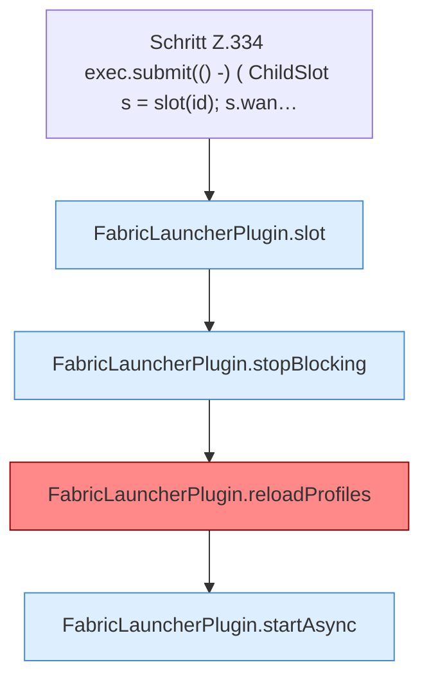

[[00 Start]] › [[Plugin-Kern]] › [[Slot-Aktionen]] › [[FabricLauncherPlugin.requestRestart(String)]] › [[FabricLauncherPlugin.requestRestart(String).Z334]]

# FabricLauncherPlugin.requestRestart(String).Z334



```knoten
Schritt Z.334 exec.submit(() -) ( ChildSlot s = slot(id); s.wan…
  Zeile 334: legt die Arbeit auf den Pool ServerhosterPlugin. `exec.submit(() -) ( ChildSlot s = slot(id); s.wan…`
FabricLauncherPlugin.slot
  `slot` in `FabricLauncherPlugin.java`. Ruft `profile`, `ChildSlot`.
FabricLauncherPlugin.stopBlocking
  Stoppt `stopBlocking`. Ruft `invalidateRestarts`, `running`, `stopProcess`.
FabricLauncherPlugin.reloadProfiles
  `Profiles.load`, danach nur `getFirst()`. Befund: angemeldet aber nicht umgesetzt (sicher).
FabricLauncherPlugin.startAsync
  Startet `startAsync`. Ruft `msg`, `slot`, `invalidateRestarts`.
```

- Fortsetzung von `FabricLauncherPlugin.requestRestart(String)`, Quellreihenfolge.
