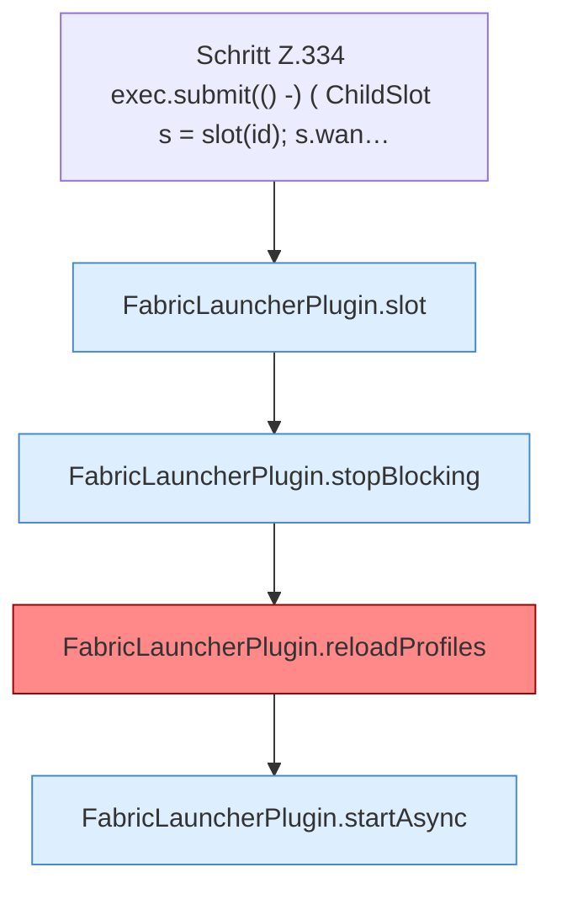

[[00 Start]] › [[Plugin-Kern]] › [[Slot-Aktionen]] › [[FabricLauncherPlugin.requestRestart(String)]] › [[FabricLauncherPlugin.requestRestart(String).Z334]]

# FabricLauncherPlugin.requestRestart(String).Z334

- Fortsetzung von `FabricLauncherPlugin.requestRestart(String)`, Quellreihenfolge.
