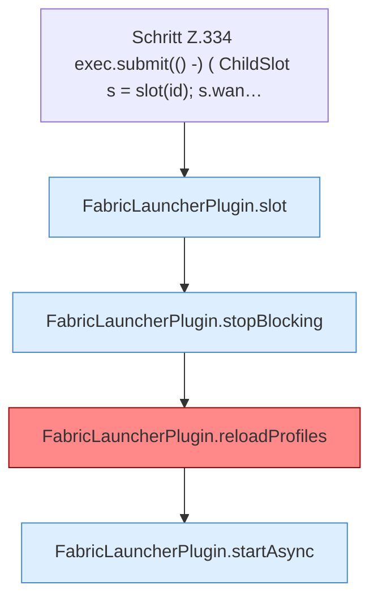

[[00 Start]] › [[Plugin-Kern]] › [[Slot-Aktionen]] › [[FabricLauncherPlugin.requestRestart(String)]] › [[FabricLauncherPlugin.requestRestart(String).Z334]]

# FabricLauncherPlugin.requestRestart(String).Z334



```knoten
Schritt Z.334 exec.submit(() -) ( ChildSlot s = slot(id); s.wan…
  Zeile 334: legt die Arbeit auf den Pool ServerhosterPlugin. `exec.submit(() -) ( ChildSlot s = slot(id); s.wan…`
FabricLauncherPlugin.slot
  Das [[Glossar#Plugin|Plugin]] macht hier einen einzelnen Schritt. Eine Ebene tiefer steht er genauer. `slot` in `FabricLauncherPlugin.java`. Ruft `profile`, `ChildSlot`.
FabricLauncherPlugin.stopBlocking
  Setzt den Zustand auf „stoppt“ und wartet, bis der [[Glossar#Spielserver|Spielserver]] wirklich aus ist. Stoppt `stopBlocking`. Ruft `invalidateRestarts`, `running`, `stopProcess`.
FabricLauncherPlugin.reloadProfiles
  Liest die Server aus den [[Glossar#Einstellungen|Einstellungen]] neu und behält nur den ersten. `Profiles.load`, danach nur `getFirst()`. [[Glossar#Befund|Befund]]: angemeldet aber nicht umgesetzt, sicher. FabricLauncherPlugin.java:266–272 getFirst verwirft servers.*
FabricLauncherPlugin.startAsync
  Beginnt den Start des [[Glossar#Spielserver|Spielservers]] im Hintergrund, damit der [[Glossar#Host|Host]] dabei nicht stehen bleibt. Startet `startAsync`. Ruft `msg`, `slot`, `invalidateRestarts`.
```

> [!knoten]- Was die Blöcke tun
> - **Schritt Z.334 exec.submit(() -) ( ChildSlot s = slot(id); s.wan…**: Zeile 334: legt die Arbeit auf den Pool ServerhosterPlugin. `exec.submit(() -) ( ChildSlot s = slot(id); s.wan…`
> - **FabricLauncherPlugin.slot**: Das [[Glossar#Plugin|Plugin]] macht hier einen einzelnen Schritt. Eine Ebene tiefer steht er genauer. `slot` in `FabricLauncherPlugin.java`. Ruft `profile`, `ChildSlot`.
> - **FabricLauncherPlugin.stopBlocking**: Setzt den Zustand auf „stoppt“ und wartet, bis der [[Glossar#Spielserver|Spielserver]] wirklich aus ist. Stoppt `stopBlocking`. Ruft `invalidateRestarts`, `running`, `stopProcess`.
> - **FabricLauncherPlugin.reloadProfiles**: Liest die Server aus den [[Glossar#Einstellungen|Einstellungen]] neu und behält nur den ersten. `Profiles.load`, danach nur `getFirst()`. [[Glossar#Befund|Befund]]: angemeldet aber nicht umgesetzt, sicher. FabricLauncherPlugin.java:266–272 getFirst verwirft servers.*
> - **FabricLauncherPlugin.startAsync**: Beginnt den Start des [[Glossar#Spielserver|Spielservers]] im Hintergrund, damit der [[Glossar#Host|Host]] dabei nicht stehen bleibt. Startet `startAsync`. Ruft `msg`, `slot`, `invalidateRestarts`.

- Der Ablauf geht in [[Glossar#Zeile|Zeile]] 334 weiter. Eine Ebene tiefer steht er genauer.
- Fortsetzung von `FabricLauncherPlugin.requestRestart(String)`.
