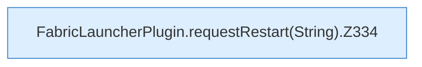

[[00 Start]] › [[Plugin-Kern]] › [[Slot-Aktionen]] › [[FabricLauncherPlugin.requestRestart(String)]]

# FabricLauncherPlugin.requestRestart(String)

`FabricLauncherPlugin.requestRestart(String id)` [src/main/java/de/aichele/childlauncher/FabricLauncherPlugin.java:334–334](https://github.com/Sciddie/minecraft-serverhoster-plugin/blob/95b02b953b0b4c23673e900e021a7c3c844aa37d/src/main/java/de/aichele/childlauncher/FabricLauncherPlugin.java#L334-L334)



```knoten
FabricLauncherPlugin.requestRestart(String).Z334
  Fortsetzung des Ablaufs ab Zeile 334.
```

- `requestRestart` in `src/main/java/de/aichele/childlauncher/FabricLauncherPlugin.java`
