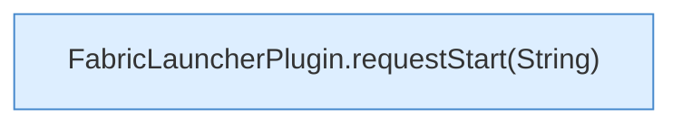

[[00 Start]] › [[Plugin-Kern]] › [[Slot-Aktionen]] › [[FabricLauncherPlugin.requestStart()]]

# FabricLauncherPlugin.requestStart()

`FabricLauncherPlugin.requestStart()` [src/main/java/de/aichele/childlauncher/FabricLauncherPlugin.java:318–318](https://github.com/Sciddie/minecraft-serverhoster-plugin/blob/95b02b953b0b4c23673e900e021a7c3c844aa37d/src/main/java/de/aichele/childlauncher/FabricLauncherPlugin.java#L318-L318)



```knoten
FabricLauncherPlugin.requestStart(String)
  Bittet darum, den [[Glossar#Spielserver|Spielserver]] zu starten. Im [[Glossar#Quelltext|Quelltext]] heißt das `requestStart(String)`.
```

> [!knoten]- Was die Blöcke tun
> - **FabricLauncherPlugin.requestStart(String)**: Bittet darum, den [[Glossar#Spielserver|Spielserver]] zu starten. Im [[Glossar#Quelltext|Quelltext]] heißt das `requestStart(String)`.

- Bittet darum, den [[Glossar#Spielserver|Spielserver]] zu starten.
- Auffällig: im normalen Betrieb ruft das niemand auf. Das nennt man [[Glossar#Ungenutzt|Ungenutzt]].
