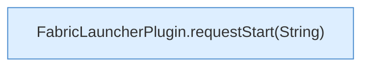

[[00 Start]] › [[Plugin-Kern]] › [[Slot-Aktionen]] › [[FabricLauncherPlugin.requestStart()]]

# FabricLauncherPlugin.requestStart()

`FabricLauncherPlugin.requestStart()` [src/main/java/de/aichele/childlauncher/FabricLauncherPlugin.java:318–318](https://github.com/Sciddie/minecraft-serverhoster-plugin/blob/95b02b953b0b4c23673e900e021a7c3c844aa37d/src/main/java/de/aichele/childlauncher/FabricLauncherPlugin.java#L318-L318)

- `requestStart` in `src/main/java/de/aichele/childlauncher/FabricLauncherPlugin.java`
- Befund: toter Code, sicher. src/main/java/de/aichele/childlauncher/FabricLauncherPlugin.java:318–318 kein Aufruf, kein Treffer in plugin.yml/UI/Strings
