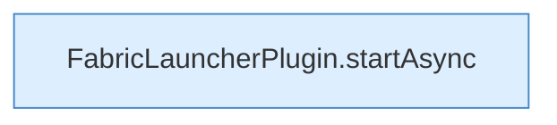

[[00 Start]] › [[Plugin-Kern]] › [[Slot-Aktionen]] › [[FabricLauncherPlugin.requestStart(String)]]

# FabricLauncherPlugin.requestStart(String)

`FabricLauncherPlugin.requestStart(String id)` [src/main/java/de/aichele/childlauncher/FabricLauncherPlugin.java:321–323](https://github.com/Sciddie/minecraft-serverhoster-plugin/blob/95b02b953b0b4c23673e900e021a7c3c844aa37d/src/main/java/de/aichele/childlauncher/FabricLauncherPlugin.java#L321-L323)



```knoten
FabricLauncherPlugin.startAsync
  Startet `startAsync`. Ruft `msg`, `slot`, `invalidateRestarts`.
```

- `requestStart` in `src/main/java/de/aichele/childlauncher/FabricLauncherPlugin.java`
