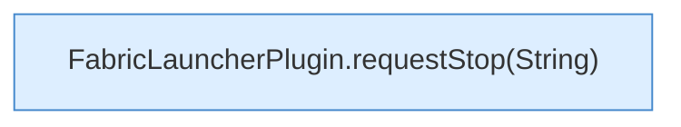

[[00 Start]] › [[Plugin-Kern]] › [[Slot-Aktionen]] › [[FabricLauncherPlugin.requestStop()]]

# FabricLauncherPlugin.requestStop()

`FabricLauncherPlugin.requestStop()` [src/main/java/de/aichele/childlauncher/FabricLauncherPlugin.java:319–319](https://github.com/Sciddie/minecraft-serverhoster-plugin/blob/95b02b953b0b4c23673e900e021a7c3c844aa37d/src/main/java/de/aichele/childlauncher/FabricLauncherPlugin.java#L319-L319)



```knoten
FabricLauncherPlugin.requestStop(String)
  Fordert an `requestStop`. Ruft `slot`, `stopBlocking`.
```

- `requestStop` in `src/main/java/de/aichele/childlauncher/FabricLauncherPlugin.java`
- Befund: toter Code, sicher. src/main/java/de/aichele/childlauncher/FabricLauncherPlugin.java:319–319 kein Aufruf, kein Treffer in plugin.yml/UI/Strings
