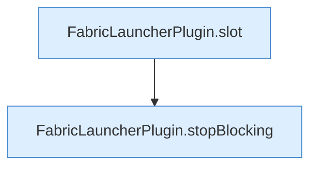

[[00 Start]] › [[Plugin-Kern]] › [[Slot-Aktionen]] › [[FabricLauncherPlugin.requestStop(String)]]

# FabricLauncherPlugin.requestStop(String)

`FabricLauncherPlugin.requestStop(String id)` [src/main/java/de/aichele/childlauncher/FabricLauncherPlugin.java:328–333](https://github.com/Sciddie/minecraft-serverhoster-plugin/blob/95b02b953b0b4c23673e900e021a7c3c844aa37d/src/main/java/de/aichele/childlauncher/FabricLauncherPlugin.java#L328-L333)

- `requestStop` in `src/main/java/de/aichele/childlauncher/FabricLauncherPlugin.java`
