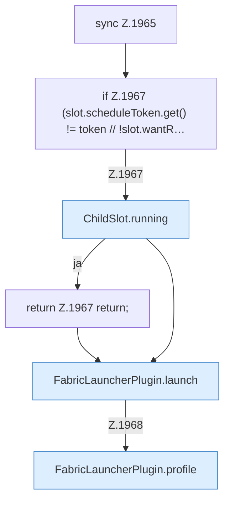

[[00 Start]] › [[Child-Prozess]] › [[Neustart]] › [[FabricLauncherPlugin.restartSingle]] › [[FabricLauncherPlugin.restartSingle.Z1965]]

# FabricLauncherPlugin.restartSingle.Z1965



```knoten
sync Z.1965
  Zeile 1965: synchronisierter Block.
if Z.1967 (slot.scheduleToken.get() != token // !slot.wantR…
  Zeile 1967: prüft `(slot.scheduleToken.get() != token // !slot.wantR…`.
ChildSlot.running
  Sagt, ob der Prozess läuft `running`.
return Z.1967 return;
  Zeile 1967: Rückgabe `return;`.
FabricLauncherPlugin.launch
  Startet den Prozess `launch`. Ruft `running`, `directory`, `copyPlayerFiles`.
FabricLauncherPlugin.profile
  `profile` in `FabricLauncherPlugin.java`.
```

- Fortsetzung von `FabricLauncherPlugin.restartSingle`, Quellreihenfolge.
